# What is left: the work graph

Every step to release markdown-db, land the evidence work, and move harness-reference and the
other corpora onto the claims profile. An arrow means "must come first". Owner steps are the
repository owner's: merges, publishing, settings and review answers. The full context for each
step is in [markdown-db-and-harness-reference.md](markdown-db-and-harness-reference.md).

```mermaid
flowchart TD
  classDef owner fill:#fde7c8,stroke:#b8741a,color:#222
  classDef doing fill:#d6e9fb,stroke:#2b6cb0,color:#222
  classDef todo fill:#f4f4f4,stroke:#888,color:#222
  classDef done fill:#d4edda,stroke:#2f855a,color:#222

  subgraph A["A · Release markdown-db from osdlc"]
    A1["Port package and standard to osdlc/osdlc: dist build, 0.1.0, release wiring (osdlc #725)"]
    A1b["Move the standard and example corpora to packages/conformance/markdown-db (SPEC.md + cases)"]
    A2["lib-publish-ready audit: 0 blockers, 10 gaps"]
    A4["@claude review on osdlc #725: no blockers, 5 points"]
    A3["Fix audit and review findings, with the spec move; re-review"]
    A5["Sign off the name, merge osdlc #725"]
    A6["Stage and publish @osdlc/markdown-db 0.1.0 to npm"]
    A7["skillwright depends on the npm package and deletes its copy"]
    A8["Add @osdlc/markdown-db to the dev repo's LIBRARIES.md"]
    A9["When mature: break markdown-db out of osdlc into its own repo"]
    A1 --> A2 --> A3
    A1 --> A4 --> A3
    A1b --> A3
    A3 --> A5 --> A6 --> A7
    A6 --> A8
  end

  subgraph B["B · Land the evidence work, skillwright #74"]
    B1["Answer the evidence page questions, at least q-names and q-focus"]
    B2["Rename references to documents and evidence to study-results; drop the harness field"]
    B3["Review the renames: @claude review on #74"]
    B4["Merge #74"]
    B1 --> B2 --> B3 --> B4
  end
  B4 --> A7

  subgraph C["C · markdown-db spec and package work, in osdlc"]
    C1["Claims profile: a second standard with VA-Spec JSON Schemas"]
    CG1["G-1 shared schemas across corpora"]
    C2["Nested x-ref"]
    C3["Folder records (decided: add now)"]
    C4["x-warn"]
    C5["Loader API and JSON build target"]
    CG2["G-2 links into non-record data: ledgers, CSV rows"]
    CG3["G-3 rules across records: value matches predicate schema, evidence floors"]
    CG4["G-4 append-only records and file hashes"]
    C6["Move capture into the profile package"]
    C7["A second implementation, for example Rust, running the spec cases"]
    CG1 --> C1
    C2 --> C1
    C1 --> C6
  end
  A5 --> CG1
  A5 --> C2
  A5 --> C3
  A5 --> C4
  A5 --> C5
  A5 --> CG2
  A5 --> CG3
  A5 --> CG4
  A5 --> C7
  C1 --> A9
  C7 --> A9

  subgraph D["D · harness-reference on the claims profile"]
    D1["Subjects and statements types in beta"]
    D2["Move the facts code reads to beta, with captured evidence"]
    D3["Point tradecraft-core profile tests at beta"]
    D4["detect-harness reads beta through the loader"]
    D5["Move the rest of alpha; retire alpha"]
    D6["Probes become methods; runs write study results"]
    D1 --> D2 --> D3
    D2 --> D5
  end
  B4 --> D1
  C1 --> D1
  CG3 --> D1
  C5 --> D4
  D2 --> D4
  C3 --> D6
  C6 --> D6

  subgraph E["E · Other adopters"]
    E1["small-model-evals: statements citing ledger slices; suites become methods"]
    E2["Fitness vault: direction on evidence, audit verdicts as dispute lines, sources as documents"]
    E3["sdlc producers: bug-finder, duplication-scan, verify match the field names"]
  end
  C1 --> E1
  CG2 --> E1
  C1 --> E2
  C1 --> E3

  subgraph H["H · Housekeeping"]
    H1["Auto-delete of head branches: on in all 9 osdlc repos"]
    H2["osdlc/osdlc#635: markdown-link finds every relative link (open fix: osdlc #651)"]
    H3["skillwright#42: markdown-contract checks record bodies"]
    H4["Validator: do not check links inside quoted excerpts"]
  end
  A5 --> H4
  A5 --> H3

  class A1,A2,A4 done
  class A1b,A3 doing
  class B1,A5,A6,B4 owner
  class H1 done
  class A7,A8,A9,C7,B2,B3,C1,CG1,C2,C3,C4,C5,CG2,CG3,CG4,C6,D1,D2,D3,D4,D5,D6,E1,E2,E3,H2,H3,H4 todo
```

Colours: green is done, blue is in progress, orange is an owner step, grey is not started.

## The shortest path to "usable elsewhere"

A1, the audit and `@claude review` (done) → A3, which also does the spec move (A1b; running)
→ A5 → A6. After A6 any project can `npm install @osdlc/markdown-db` and run
`markdown-db validate`. Nothing in B to E blocks it.

## The shortest path to "code reads beta"

B1 → B2 → B3 → B4, and A5 → G-1, nested `x-ref`, G-3 → C1, then D1 → D2 → D3.
