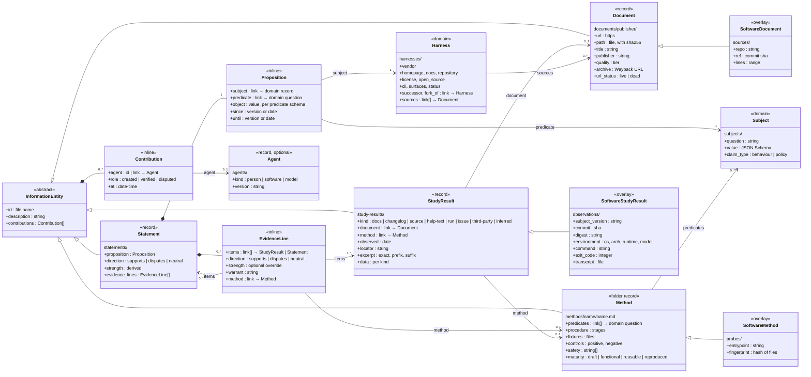

# Claims profile: class diagram

The proposed claims profile of markdown-db, after GA4GH VA-Spec, with harness-reference as the
domain and the optional software overlay. Stereotypes:

- `record`: its own file. `folder record`: a folder holding `<name>.md` and its files.
- `inline`: an object inside another record.
- `domain`: supplied by the corpus, not the profile.
- `overlay`: the optional software overlay, an `allOf` layer over a base class.

Links are relative Markdown links checked with `x-ref`. Inline objects that hold links need nested
`x-ref` (roadmap item 3).

Read it as:

- A **Statement** is the claim. Its **Proposition** names the domain record (a harness), the
  domain question (a subject) and the value.
- Each **Evidence Line** argues for or against the statement from one or more **Study Results**
  (or other statements), with a direction and a reason.
- A **Study Result** is one observation of a **Document** or one run of a **Method**. It points at
  nothing in the domain; the statements that cite it do.
- Every record carries **Contributions**: who created, verified or disputed it, and when.
- **Harness** and **Subject** belong to harness-reference. Another corpus swaps in its own, such
  as models and jobs in small-model-evals.
- The **software overlay** adds version, commit, environment and transcript fields, and renames
  the folders (`observations`, `probes`, `sources`). Its schemas say which class they implement
  with `x-class`.
