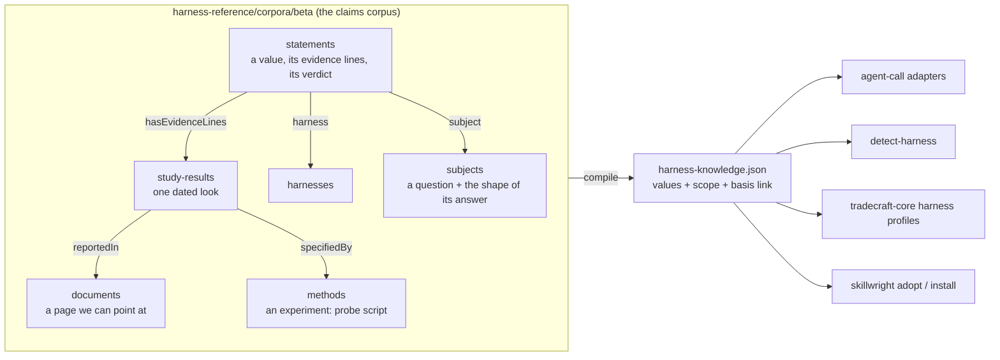

# Plan: harness knowledge from evidence

**Goal:** turn harness-reference into a claims corpus, and compile that corpus into one small
data file that tools look values up in. Every value in the file links back to the statement
that sets it. From the statement a reader can reach its evidence.

The corpus is never compiled into a tool or shipped with one. Tools ship the derived file only.

Status: draft, 2026-11-09.

## The shape



### Record types

The four evidence types are the [claims profile](https://github.com/osdlc/markdown/pull/6)
(VA-Spec 1.1.0), copied in until corpus-schema can resolve a profile package. Records are open,
so the harness fields below are extensions on the profile's types, not new schemas.

| Type | From | Holds | Harness extensions |
|---|---|---|---|
| `documents` | beta `references` | One page: docs, changelog, source file, release list, research note | `publisher`, `archive`, `url_status` (beta's fields, kept) |
| `methods` | `probes/` | One experiment: its steps in the body, its script beside it in a record folder | `harnesses`, `subjects`, `commands`, `record`, `safety` |
| `study-results` | beta `evidence`, alpha observations | One dated look. It quotes a document, or records one run of a method. It claims nothing | `kind`, `harness`, `version`, `version_basis`, `observed`, `locator`, `excerpt` |
| `statements` | alpha facts | One value for one harness and subject, its evidence lines, and its verdict | `harness`, `subject`, `scope`, `status`, `supersedes` |
| `harnesses` | beta, unchanged | One harness | none |
| `subjects` | alpha subjects and categories | One question and the shape of its answer | `category`, `model_dependent`, `valueSchema` |

### What an observation is

A **study result**. It is one of two things:

- **A page someone read** (`kind`: docs, changelog, source, help-text, issue, third-party).
  `reportedIn` links the document, `excerpt` quotes the words, and `version` says which release
  it describes.
- **An experiment someone ran** (`kind`: run). `specifiedBy` links the method, which holds the
  probe script. The run's output sits beside the study result in its record folder.

`inferred` is the third kind: a conclusion drawn from other study results, which it names.

A study result never states a value. A statement does: it cites study results in its evidence
lines and gives the verdict.

### A statement

```yaml
proposition:
  subject: "[Claude Code](../harnesses/Claude%20Code.md)"
  predicate: cli/session-env
  object: { vars: [CLAUDE_CODE_SESSION_ID, CLAUDE_PID] }  # checked against the subject's valueSchema
direction: supports
strength: strong
hasEvidenceLines:
  - hasEvidenceItems: ["[2026-10-10 session env run](../study-results/Claude%20Code/2026-10-10%20session%20env%20run/2026-10-10%20session%20env%20run.md)"]
    directionOfEvidenceProvided: supports
    strengthOfEvidenceProvided: strong
    description: A print-mode run listed both variables.
contributions:
  - { contributor: { name: harness-reference import, agentType: software }, activityType: created, date: 2026-11-09T00:00:00Z }
# harness extensions
harness: "[Claude Code](../harnesses/Claude%20Code.md)"   # x-ref harnesses
subject: "[Session environment](../subjects/cli/Session%20environment.md)"  # x-ref subjects
scope: { since: null, until: null, platform: [], model: null }
status: current            # current | superseded | disputed | open
supersedes: null           # x-ref statements
```

`harness` and `subject` repeat `proposition.subject` and `proposition.predicate` because
corpus-schema allows `x-ref` only on top-level fields. A lint keeps them equal. They collapse
into the proposition once nested `x-ref` lands
([osdlc/markdown#8](https://github.com/osdlc/markdown/issues/8), gap 2).

### Strength from evidence

The importer sets strength by rule; a reviewer may lower it, never raise it above the rule.

| Best evidence kind on a supporting line | Line strength |
|---|---|
| run, source, help-text | strong |
| docs, changelog | moderate |
| issue, third-party, inferred, research note only | weak |

A statement's strength is its strongest supporting line, dropped one step when any line
disputes it.

### Rules a schema cannot hold

A `lint` script in `src/beta/` checks the rules that compare records:

- `proposition.object` validates against the subject's `valueSchema`.
- `proposition.subject` and `predicate` match `harness` and `subject`.
- `scope.model` only on subjects with `model_dependent: true`.
- `scope.since` and `scope.until` forbidden when the harness's `versioning` is `unknown`.
- At most one `current` statement per (harness, subject, platform, model) scope cell with
  overlapping version ranges.
- A `supersedes` target has `status: superseded`.
- A `run` study result has `specifiedBy`, and its method lists the harness.

## The derived file

`harness-reference compile` reads the corpus and writes `harness-knowledge.json`:

```jsonc
{
  "schema": 1,
  "corpus": { "repo": "osdlc/skillwright", "path": "harness-reference/corpora/beta", "commit": "<sha>" },
  "harnesses": { "claude-code": { "title": "Claude Code", "versioning": "semver", "cli": "claude" } },
  "subjects":  { "cli/session-env": { "title": "Session environment", "category": "cli", "valueSchema": {} } },
  "values": [
    {
      "harness": "claude-code", "subject": "cli/session-env",
      "value": { "vars": ["CLAUDE_CODE_SESSION_ID", "CLAUDE_PID"] },
      "scope": { "since": null, "until": null, "platform": [], "model": null },
      "strength": "strong",
      "basis": "https://github.com/osdlc/skillwright/blob/<sha>/harness-reference/corpora/beta/statements/..."
    }
  ]
}
```

- Only `current` and `disputed` statements go in. Disputed values carry `"disputed": true` so a
  consumer can refuse them.
- `basis` is a permalink at the corpus commit, so it never moves.
- Evidence lines, study results, documents and prose stay out.
- Harness and subject keys are slugs of the record names, fixed by a `slug` field on each record
  so a rename does not change them.
- A JSON Schema for the file, and generated TypeScript types, ship beside it.

**Lookup:** `lookup(harness, subject, { version?, platform?, model? })` returns
`{ value, strength, basis }` or `undefined`. It picks the value whose scope contains the version;
with no version it picks the one with `until: null`.

**Packages:**

- npm `@osdlc/harness-knowledge`: the JSON file, its schema, types, and `lookup`. Versioned on
  its own; a new corpus commit that changes the file is a new version.
- Rust: `tradecraft-core` embeds the same file with `include_str!` and deserializes it into typed
  structs generated by tradecraft-typegen. No separate crate until a second Rust consumer needs it.

## Where the policies stay

The mapping rules stay in code: agent-call's adapters ("read-only" becomes a tool deny list for
claude, `--sandbox read-only` for codex) and skillwright's translators. Those adapters and
translators read their per-harness facts from the derived file instead of keeping their own
tables, and tests check each adapter against it.

This amends [D-FDLQ](../decisions/D-FDLQ-harness-profile-and-translator.md): a harness profile's
*values* now come from the derived file rather than a hand-written row. The translator trait and
the profile's shape are unchanged. A new decision record, D-xxxx, says so when phase 5 lands.

## Phases

| # | Phase | Output | Depends on |
|---|---|---|---|
| 1 | **Profile types in beta.** Rename `references` to `documents` and `evidence` to `study-results` with their extensions. Add `methods`, `statements`, `subjects` schemas. Copy the claims profile schemas with a pinned source commit. Add `lint`. | beta validates; lint passes; existing beta records migrated | — |
| 2 | **Importer, pilot.** `src/beta/import-alpha.ts` converts one category (`cli`) of alpha: sources and notes to documents, probes to methods, observations to study-results, facts to statements, with strength by rule. Idempotent: rerunning writes the same files. | ~60 statements; diff reviewed by a person | 1 |
| 3 | **Compiler and lookup.** `src/compile/` writes `harness-knowledge.json` and its schema; `lookup` and tests. | the file for the pilot slice | 2 |
| 4 | **Full import.** All 589 facts and 11 categories. Value shapes written as `valueSchema` per subject; facts whose values don't fit get fixed by hand. | the full file; alpha frozen | 2 |
| 5 | **First consumers.** agent-call's adapters and detect-harness (osdlc/osdlc) read the npm package; tradecraft-core's profiles read the embedded file. Decision record amending D-FDLQ. | consumer PRs | 3, 4 |
| 6 | **Drift loop.** Probes run in CI on a schedule; a new run writes a study result; the lint flags statements whose evidence now disputes them; the compiler refuses a disputed value a consumer depends on. | scheduled workflow | 5 |
| 7 | **Retire alpha.** Delete the alpha corpus, its validator and page generator; generate pages from statements. | — | 4 |

Phases 1 to 3 land together as the first implementation PR. Phase 4 is mechanical and large, so it
gets its own PR.

## Decisions taken in this plan

1. **Use the profile names** (`documents`, `methods`, `study-results`, `statements`) in beta now,
   while beta holds only a few dozen records. Renaming later costs more.
2. **One statement per (harness, subject, scope)**, with history as `supersedes` links, not an
   array of observations.
3. **Value shapes live on the subject** as `valueSchema`, checked by the lint, until
   corpus-schema can choose a schema by a field's value.
4. **Values go straight into consumers** when their strength is moderate or strong. A weak value
   is in the file but a consumer must opt in to use it.
5. **The derived file is the only interface.** No consumer reads the corpus.

## Open questions

1. Does `harness-knowledge` publish from skillwright's release pipeline, or from osdlc/osdlc
   where agent-call lives? Recommend skillwright, beside the corpus, so a corpus change and its
   file version ship together.
2. When the claims profile becomes `@osdlc/corpus-profile-claims`, beta switches from copied
   schemas to the package. Track with osdlc/markdown tasks 9 and 23.
