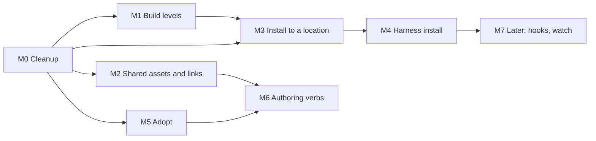

# Roadmap after v2

## Goal

v2 ships four commands, `init`, `build`, `check` and `bump`, over one fixed
layout ([structure-v2.md](structure-v2.md)). This roadmap brings back the v1
features that have real users, one major feature at a time, built on the osdlc
libraries.

The owner wants:

- most of the v1 features, done cleanly on the osdlc libraries;
- builds at different levels;
- installs to different locations;
- links rewritten across plugins, and assets shared between all plugins;
- one major feature at a time.

## Principles

1. **One major feature per milestone.** Each milestone gets its own spec
   section, its own plan and its own PR, as v2 did with
   [structure-v2.md](structure-v2.md), [v2-plan.md](v2-plan.md) and one PR.
   M0 is the exception: it changes no spec and lands as several PRs.
2. **Lean on the osdlc libraries.** Code that a library does, or should do,
   goes to the library. skillwright keeps only its own rules: the layout,
   link scope, calls and the pack table.
3. **The fixed v2 layout stays.** A milestone may add a folder or a key. It
   never makes a layout that v2 accepts mean something else.
4. **Each milestone leaves the codebase as tight as M0 left it.** The bar,
   checked in review:
   - no local copy of a job an osdlc library does;
   - no public item whose only callers are tests;
   - no new or changed function over 80 lines;
   - one shared test helper module per crate, and no copied helpers;
   - every refusal token comes from the `refusal` module and is documented;
   - the M0 seams are used, not bypassed: plan once over owned paths, one
     `Harness` enum, one `Scope`, one frontmatter reader.
5. **A milestone waits for a library release only where the table says so.**
   Where it does not wait, skillwright uses the current release and moves to
   the new one in a follow-up PR inside the same milestone.

## Order

| Milestone | Problem it solves | Who needs it (evidence) | skillwright work | Library work | Size | Depends on |
|---|---|---|---|---|---|---|
| **M0. Cleanup** | The code has duplicated helpers, dead paths and local copies of library jobs. The seams the next features need do not exist yet. | The owner. Issues [#46](https://github.com/osdlc/skillwright/issues/46), [#47](https://github.com/osdlc/skillwright/issues/47), [#50](https://github.com/osdlc/skillwright/issues/50), [#141](https://github.com/osdlc/skillwright/issues/141). `cargo install skillwright` builds two markdown-link versions ([#155](https://github.com/osdlc/skillwright/pull/155)). | The 12-step cleanup below: about -3,000 lines. Plan once over owned paths, one `Harness` enum, one `Scope`, structured refusals, one frontmatter reader. | markdown-link: [osdlc/osdlc#649](https://github.com/osdlc/osdlc/pull/649), [osdlc/osdlc#651](https://github.com/osdlc/osdlc/pull/651), `select` moved in, reference definitions and escapes as tokens (**wait**). typed-git: `toplevel`, `ls_tree`, `paths_into` (**wait**). vfs-walk: `empty_dirs` (**wait**). path-guard: one `Vfs` resolver, `lexical::relative` (**wait**). frontmatter-lossless: `LenientSplit::yaml_range` (**wait**). vfs-seam 0.2.1 (released). | Large, about 7 PRs | none |
| **M1. Build levels** | `build` builds a whole marketplace or nothing. A release of one plugin needs a script. | skillwright's own `.github/workflows/plugin-release.yml` runs `scripts/plugin-marketplace.ts sync` after a whole build. M3's sync of one plugin needs it. | `--plugin 
` on `build`, `check` and `bump`. A plugin build owns only its packs and its manifest entries. | None required. typed-git git-tree `Vfs` for an in-memory baseline (no wait). | Small to medium | M0 steps 1 to 8 |
| **M2. Shared assets and cross-plugin links** | A file used by several plugins must be copied into each by hand. A link to another plugin is refused. Path-form calls are gone. | dev `solutions/ontological/plugin/skillwright.md`: 29 `build.assets` entries, `work-identity.mjs` in both `craft` and `sdlc`. 16 `sdlc` skills link `craft` references. 38 path-form calls. [#156](https://github.com/osdlc/skillwright/issues/156): 91 of 295 wikilinks in one vault embed notes outside any plugin. | `marketplaces/<m>/shared/`, copied into each pack that uses it. Step 3 of name lookup. The qualified call `/[[
:<s>]]`. | markdown-link: scoped `LinkIndex` (no wait). markdown-link or markdown-corpus: cross-root index, shared with osdlc/markdown tasks 27 and 29 (no wait). | Large | M0 |
| **M3. Install to a location** | Output stops at `dist/<m>/`. Copying it to a repo root, another marketplace repo or a skills folder is a script, with no drift check. | dev `moon.yml:504` (`publish --all`), `scripts/guard-project-skills.ts` (`status --check` in CI), `solutions/ontological/plugin/skillwright.md:6` (`out: ..`), the committed trees under `solutions/ontological/`. skillwright's `plugin-marketplace.ts sync`. The determined app's `publish_note` and `get_publish_status`. | `sync` (copy packs and catalog entries into a tree), `publish` (plain skills into a skills folder), `status [--check]`, deletes through a ledger. | New crate `install-ledger` (**wait**). etag-write: a `Vfs` form and a tree swap (**wait**). agent-adapt: skills-folder paths agree with harness facts (no wait). | Large | M0, M1 |
| **M4. Harness install** | Installing a marketplace into a harness has no command. | osdlc `packages/gh-actions/agent-setup/setup.sh:234` runs `skillwright harness install --git-url`, pinned to 0.7.0, and fakes an empty vault to do it. | `harness install`, `update`, `uninstall`, `link`, `unlink`, through each harness's own plugin CLI. | agent-adapt: a `cli` module with per-harness adapters through a spawn seam (**wait**). New Rust `harness-knowledge` crate (**wait**). | Medium to large | M0, M3 |
| **M5. Adopt** | Existing `SKILL.md` folders cannot be read into a vault. | The determined app: `adopt_skills_into_vault`, `get_adopt_preview`, `detect_format` in dev's `determined-agent-skills`. [#51](https://github.com/osdlc/skillwright/issues/51). | `adopt <source>` and `adopt --from-git`, into `plugins/
/skills/<s>/<s>.md`. | agent-adapt: a parse direction for each renderer (**wait**). typed-git git-tree `Vfs` (**wait**). yaml-splice or frontmatter-lossless: a note-level field edit (**wait**). | Medium | M0 |
| **M6. Authoring verbs** | Creating, renaming and moving notes, with links rewritten, has no command. | The determined app: `create_note`, `rename_component`, `rename_plugin`, `rename_marketplace`, `move_component`, `delete_component`, `convert_kind`. | `new`, `rename`, `move`, `delete`. | markdown-relink and markdown-corpus: an injected resolver and a `Vfs` `execute` (**wait**). | Medium | M2, M5 |
| **M7. Later: hooks and watch** | Hook notes, Cursor hooks and `build --watch`. | No user found. [#152](https://github.com/osdlc/skillwright/issues/152). | Specced when a user appears. | agent-adapt hook rendering. A file-watch crate. | Small each | M4 for watch |

### Why this order

- **M0 first.** It builds the seams that M1 to M4 plug into: plan once over
  owned paths, one `Scope`, one `Harness` enum and the typed-git verbs.
  Building features first would add a fifth translator impl, a third request
  type and more copies of the git and link code.
- **M1 before M2.** M1 is small, and M3 needs it. M2 needs the most library
  work, so it goes second, once M0's markdown-link moves have landed.
- **dev moves at M3, not M2.** dev also needs `out: ..` and project-skill
  `publish`, which are M3. So putting M2 first would not let dev move sooner.
- **M4 can move up.** It needs only M0 and M3's ledger. If osdlc
  `agent-setup` becomes urgent, M4 can go before M3 with `link` deferred to
  after M3.
- **Adopt and authoring are two milestones.** They read and write different
  things and wait on different library work. One milestone for both would
  break principle 1.

### Where the inputs disagreed

| Disagreement | Resolution |
|---|---|
| The feature inventory puts shared assets first, because dev cannot move without it. The ecosystem review puts cleanup and levels first. | Cleanup and levels first. dev cannot move before M3 in either order (see above). |
| The cleanup audit says to build cross-plugin link rewriting after install to a location, because the translator would compute a path across two install roots. | M2 never writes a path across packs. A file used by several plugins is copied into each pack, so every link stays inside one pack. M2 does not need M3. |
| The ecosystem review places the scoped `LinkIndex` alongside build levels. | M1 does not change how links resolve, so it moves to M2, where resolution gains a step. |
| v1 kept the install record in tradecraft-core. The ecosystem review proposes a new `install-ledger` crate. | A new crate. dev, sdlc and agent-adapt's `install` have the same need. |
| The issue assessment ranks `publish` first among features to bring back. | It is in M3. It needs M0's owned-path seam and M1's plugin level. |

### Spec versioning

**Q1. Does each milestone amend [structure-v2.md](structure-v2.md) in place,
or start a v3 spec?** Recommendation: amend in place when the change only adds
(a new folder, key, command or call form). Start v3 only for a breaking
change. No milestone here plans one.

## M0. Cleanup

### Scope

In:

1. **Delete dead weight.** Unused dependency `unicode-normalization`; public
   items with no caller; options that are always `Some`; dead profile fields;
   render data that is computed and dropped; vfs-seam 0.2.1; stale comments.
   About -310 lines.
2. **Compile always records.** Remove the render-only path that only tests
   reach. About -210.
3. **Structured refusals.** `Refused { token, message }`, one `refusal`
   module of tokens, no `RootNotFound`, "vault root" in place of "corpus
   root", one CLI failure helper. About -50.
4. **One `Harness`, one translator.** A `Harness` enum replaces
   `PluginDialect`, `HARNESS_BLOCKS`, the name matches and wasm's `Target`.
   `HarnessTranslator` becomes one struct. `PluginFormat` embeds
   `PluginPolicy`. One `carries(kind)`. About -355.
5. **One scope and one identity.** `Scope { Vault, Marketplace, Plugin }` in
   both public requests. `Position` inside `DiscoveredComponent`. `load_for`
   split into steps. About -185.
6. **Plan once, swap over owned paths.** A public `plan`, `VaultPlan::report`
   and `VaultPlan::commit`. The swap takes a list of owned paths, not a
   profile. The CLI plans, confirms and commits once. About -155.
7. **Split the big files.** `compile/`, `export/`, the module tree laid out as
   the pipeline. About -105.
8. **CLI runner and bump split.** One `RunFlags`, a report sink, `bump/` in
   three files, CLI path helpers out of the core. The layout walk checks
   containment through `guard::within`, so one place decides it. About -165.
9. **typed-git verbs.** Move bump's git plumbing to typed-git. Reuse the
   run's scan in `bump --changed-since` ([#141](https://github.com/osdlc/skillwright/issues/141)).
   About -400.
10. **markdown-link moves.** Merge [#155](https://github.com/osdlc/skillwright/pull/155).
    Land [osdlc/osdlc#649](https://github.com/osdlc/osdlc/pull/649) and
    [osdlc/osdlc#651](https://github.com/osdlc/osdlc/pull/651). Then delete
    `code_regions`, `opens_markdown_link`, `is_blank_line`,
    `written_destination` and most of `markdown_destinations`. Use
    `relative_link` in place of `markdown_at` and `relative_path`. Use
    vfs-walk for the output scan. Drop markdown-contract. About -380.
11. **One frontmatter reader.** Drop serde_yaml. One removed-key table. Use
    agent-adapt's slug rules. About -315.
12. **Test consolidation.** Shared helper modules, one fixture vault, the
    parity test folded into the golden test. About -550.

Steps 1 to 8 are in skillwright only. Steps 9 to 11 wait on library releases.
Step 12 can land any time after steps 5 and 6.

Out: any change to the spec, any new command or flag, and the in-memory git
baseline (M1 stretch).

### v2 rules it touches

None of the spec. Two wire changes need a CHANGELOG entry:

- refusals carry a separate token, and the wording says "vault root";
- `UnitStatus` becomes `Same` or `Differs`, and `DiscoveredComponent` carries
  `Position`. The TS types are regenerated.

### Acceptance criteria

- [ ] [#155](https://github.com/osdlc/skillwright/pull/155) is merged, and a
      lockfile-free `cargo tree -d` in CI shows one markdown-link.
- [ ] Every osdlc pin is at its crates.io release.
- [ ] Each of the 12 steps above has landed, each PR passing the v2 gates.
- [ ] One CLI `build` walks the vault once.
- [ ] Harness names are a `Harness` enum everywhere, including the wasm wire.
- [ ] No refusal token is a string literal outside the `refusal` module, and a
      test checks each token is documented.
- [ ] serde_yaml, markdown-contract and unicode-normalization are gone from
      every `Cargo.toml`.
- [ ] bump has no hand-built git argv.
- [ ] [#46](https://github.com/osdlc/skillwright/issues/46),
      [#47](https://github.com/osdlc/skillwright/issues/47),
      [#50](https://github.com/osdlc/skillwright/issues/50) and
      [#141](https://github.com/osdlc/skillwright/issues/141) are closed.
- [ ] The workspace is at least 2,500 lines smaller than at the start of M0.
- [ ] The README points at osdlc/markdown's `docs/ecosystem-plan.md`
      (ecosystem plan task 19).

### Owner questions

- **Q2. Does M1 wait for all of M0?** Recommendation: no. M1 starts after
  step 8. Steps 9 to 12 finish alongside M1, and M0 closes before M2 starts,
  because M2 rewrites the code that step 10 replaces.
- **Q3. How are the wire and error changes released?** Recommendation: one
  minor release of tradecraft-core and skillwright at the end of step 8, with
  the changes listed under "Changed" in the CHANGELOG.

## M1. Build levels

### Scope

In:

- `--plugin 
` on `build`, `check` and `bump --changed-since`. With more
  than one marketplace, it needs `--marketplace <m>` when the name is not
  unique.
- A plugin build owns `<packs>/
` for each harness built, and the plugin's
  entry in each marketplace manifest. Other packs and entries stay as they
  are.
- `check --plugin 
` compares only what that plugin owns.
- The stale-plugin sweep runs only over the owned paths.
- `build.harnesses` and `--harness` stay as they are.

Out: a skill-level build, a harness-level build (already `--harness`), and
writing anywhere but `dist/<m>/`.

### v2 rules it touches

- Section 9 rule 4 (`foreign-tree`): it applies per owned path.
- Section 9 rule 15 (`check`): it compares the owned paths of the scope.
- Section 10 rules 2, 3 and 5: a new flag.
- D2: a call to a plugin outside the build still resolves, since the whole
  marketplace is loaded.

### Acceptance criteria

- [ ] `build --plugin p` changes no byte outside `<packs>/p` and p's manifest
      entries.
- [ ] `check --plugin p` exits 1 on drift in p and 0 on drift only in other
      plugins.
- [ ] A plugin build refuses what a whole build refuses: a call that resolves
      to nothing, a name two plugins share and a link out of scope.
- [ ] A plugin build into an empty `dist/<m>/` writes a manifest with only p's
      entry.
- [ ] `bump --changed-since <ref> --plugin p` compares only p.
- [ ] skillwright's `plugin-release.yml` uses `build --plugin`, and
      `scripts/plugin-marketplace.ts` keeps only its copy step (removed in
      M3).

### Owner questions

- **Q4. What does "levels" mean?** Recommendation: three build levels: vault
  (no flag), marketplace (`--marketplace`) and plugin (`--plugin`). Harness is
  a separate axis that `--harness` already covers. There is no skill level for
  `build`, because a harness installs a pack, not a skill. Choosing skills
  belongs to `publish` in M3.
- **Q5. Does a plugin build rewrite the whole marketplace manifest?**
  Recommendation: no. It writes only its own entry. Rewriting the whole file
  would change other plugins' versions in the catalog while their packs stay
  old.
- **Q6. Is a plugin build checked against the whole marketplace?**
  Recommendation: yes. The whole marketplace is loaded and checked. Only the
  output is narrowed. A narrower load would let a call or name clash through.

## M2. Shared assets and cross-plugin links

### Scope

In:

- A marketplace-level folder `marketplaces/<m>/shared/` holding
  `references/`, `scripts/` and `assets/`.
- A plugin uses a shared file by linking, embedding or naming it with
  `${PLUGIN_ROOT}/<path>`. A file nothing in the plugin names can be listed in
  the plugin note (key `shared:`).
- Each shared file a plugin uses is copied into its pack at the same path its
  own file would have: `shared/scripts/x` ships as `<pack>/scripts/x`.
- Name lookup gains step 3, `shared/`, after the plugin's own folders.
- A shared note's links are re-expressed from where it lands in each pack.
  Shared files may use other shared files, and the closure is copied.
- A qualified call, `/[[
:<s>]]`, for a name two plugins share.
- A link into another plugin's folder stays refused. The error names the file
  and says to move it to `shared/`.
- [#147](https://github.com/osdlc/skillwright/issues/147): warn on a plain
  path that looks like it leaves the plugin. Also check Markdown under
  `scripts/` and `assets/`, the part [#144](https://github.com/osdlc/skillwright/issues/144)
  left open.
- Evidence for rendering: run the [#148](https://github.com/osdlc/skillwright/issues/148)
  and [#149](https://github.com/osdlc/skillwright/issues/149) probes, and
  answer the Agent Plugins half of [#150](https://github.com/osdlc/skillwright/issues/150)
  from the spec.

Out: sources outside `marketplaces/<m>/`, sharing across marketplaces,
arbitrary landing paths (v1's `to:`), the vault-path call form, and author-time
moves of shared files (M6). Build steps ([#151](https://github.com/osdlc/skillwright/issues/151))
are a stretch, taken only if dev's migration shows a moon task is not enough.

### v2 rules it touches

- Section 3: the `marketplaces/<m>/` row of "What a folder may hold", and rule
  10 ("There is no shared folder across plugins").
- Section 4: the scope table and rule 3 (two steps become three).
- Section 9: a new row in "What a pack holds".
- D2: the qualified call form.
- D4: amended. A file shared by several plugins lives once in `shared/`.
- Containment rule 1 is unchanged: nothing resolves outside
  `marketplaces/<m>/`.

### Acceptance criteria

- [ ] `![[attribution#Rule]]` in two plugins builds, with
      `shared/references/attribution.md`, and each pack holds one copy
      ([#156](https://github.com/osdlc/skillwright/issues/156)).
- [ ] A shared file no plugin uses ships nowhere.
- [ ] A shared file at the same pack path as a plugin's own file is an error
      that names both.
- [ ] `${PLUGIN_ROOT}/scripts/x` finds `shared/scripts/x` when the plugin has
      no `scripts/x`, and renders per harness as section 4 says.
- [ ] A link from a shared note to another shared note resolves in every pack
      that copies both.
- [ ] A link from a shared note to a plugin's file is refused.
- [ ] `/[[craft:decision-make]]` renders each harness's call. A vault-path
      call is refused, and the error gives the qualified spelling.
- [ ] A link into another plugin's folder is refused with a hint to use
      `shared/`.
- [ ] dev's `solutions/ontological/plugin/` builds on v2 with no `build.assets`
      entry, its launcher paths written as `${PLUGIN_ROOT}/scripts/...`.
- [ ] [#147](https://github.com/osdlc/skillwright/issues/147),
      [#148](https://github.com/osdlc/skillwright/issues/148),
      [#149](https://github.com/osdlc/skillwright/issues/149),
      [#150](https://github.com/osdlc/skillwright/issues/150) and
      [#156](https://github.com/osdlc/skillwright/issues/156) are closed.

### Owner questions

- **Q7. How are shared assets declared, and where do they live?**
  Recommendation: in `marketplaces/<m>/shared/`, with the same three folders as
  a plugin. A plugin takes a file by using it, plus a `shared:` list in the
  plugin note for files nothing links, such as a script only `hooks.json`
  runs. Using a file is already a declaration, so a second list for every file
  would be duplication.
- **Q8. Where does a shared file land in a pack?** Recommendation: at the
  path the plugin's own file would have, under `references/`, `scripts/` or
  `assets/`. No arbitrary path. A clash with the plugin's own file is an error.
  This keeps one rule for what a pack holds.
- **Q9. May a shared source sit outside `marketplaces/<m>/`?**
  Recommendation: no. Containment rule 1 stays. The author's build step copies
  a built file in first (section 3 rule 16). Build steps in `skillwright.md`
  ([#151](https://github.com/osdlc/skillwright/issues/151)) can come later.
- **Q10. How does a cross-plugin link render on each harness?**
  Recommendation: never as a path from one pack into another. Each harness
  installs each pack on its own, so such a path breaks. A file used by several
  plugins goes in `shared/` and is copied into each pack. The link then
  renders as an ordinary relative link inside the pack on Claude Code, Codex,
  Cursor and Pi alike. A plugin-root path renders as `${CLAUDE_PLUGIN_ROOT}/…`
  on Claude Code and as a relative path elsewhere, as today.
- **Q11. Do path-form calls come back?** Recommendation: not the vault-path
  form. Add `/[[
:<s>]]`, which matches how Claude Code writes the call and
  stays valid when files move. dev's 38 path-form calls are rewritten
  mechanically.
- **Q12. Can plugins in different marketplaces share files?**
  Recommendation: no. Each marketplace stays self-contained. A root-level
  `shared/` can come later if a vault with two marketplaces needs it.

## M3. Install to a location

### Scope

In:

- `sync`: copy packs and catalog entries from `dist/<m>/` into another tree,
  such as a repository root or another marketplace repository. With
  `--plugin`, it merges one plugin's pack and entry into a manifest it does
  not fully own.
- `publish`: write plain skills into a harness's skills folder, such as
  `<repo>/.claude/skills/`, with that harness's naming.
- `status [--check]`: for each destination, report each unit as current,
  stale, foreign or missing. `--check` exits 1 on any problem.
- A ledger at each destination records what skillwright wrote, from which
  source, with which hash. A removed skill is deleted from the destination.
- Destinations declared in `skillwright.md`, and `--to <path>` for one run.
- The publish rails: refuse a destination that is, holds or sits inside
  `marketplaces/`, and ask before writing into a folder that already holds
  content.

Out: publish targets beyond the four harnesses, per-machine destination files,
user-level installs through a harness CLI (M4), and agents or commands in a
skills folder.

### v2 rules it touches

- D1 stays: `build` writes only `dist/<m>/`. `sync` and `publish` read from it.
- Section 9 rule 6 ("Copying the output ... is the consumer's job") is
  amended.
- Section 2 rule 5: `build.destinations` stays refused. The new key has a new
  name and shape.
- Section 9 rule 15: `check` stays as it is.
- Section 10: three commands.

### Acceptance criteria

- [ ] dev's `solutions/ontological/plugin/` drops `out: ..`, and a declared
      `sync` writes the committed trees under `solutions/ontological/`.
- [ ] dev's project skills build from `marketplaces/<m>/plugins/
/`, and
      `publish` writes `.claude/skills/` with no byte change on a second run.
- [ ] `status --check` replaces dev's `scripts/guard-project-skills.ts` checks,
      orphan checks included.
- [ ] skillwright's `plugin-release.yml` uses `sync --plugin`, and
      `scripts/plugin-marketplace.ts` is deleted.
- [ ] A destination file skillwright did not write is never changed or
      removed. `publish` refuses, and `--overwrite <path>` clears one file.
- [ ] A skill removed from the vault is removed from the destination on the
      next `publish`.
- [ ] A destination inside `marketplaces/` is refused.
- [ ] The writes go through the M0 owned-path swap, and roll back on failure.
- [ ] [#142](https://github.com/osdlc/skillwright/issues/142)'s design notes
      on ownership across runs are covered by the ledger tests.

### Owner questions

- **Q13. Does install write outside the vault, and how do `check` and
  `status` see it?** Recommendation: yes, but only `sync` and `publish`, and
  only to declared destinations or `--to`. `build` and `check` stay inside the
  vault. `status` reads each destination's ledger. CI runs `check` for the
  vault and `status --check` for the destinations.
- **Q14. Is v1's `--out` a sync step?** Recommendation: yes. `out: ..` becomes
  a `sync` destination `to: ..`. `--out` on `build` stays removed, so the
  overlap checks D1 removed stay removed.
- **Q15. Where are destinations declared?** Recommendation: in
  `skillwright.md`, relative to the root, with `--to` for one run. No
  per-machine file in M3. tiered-dirs comes in only if user-level
  destinations are wanted.
- **Q16. Does skillwright own deletes at a destination?** Recommendation:
  yes, through the ledger. It deletes only what the ledger says it wrote. This
  replaces v1's `unpublish` stub.
- **Q17. Which targets does `publish` write?** Recommendation: the four
  harnesses only. `portable`, `opencode`, `copilot`, `amp`, `antigravity` and
  the aliases stay removed until a user needs one.
- **Q18. May a project vault skip the marketplace and plugin notes?**
  Recommendation: no. A project vault is one marketplace with one plugin.
  `publish` writes only its skills. One layout serves both cases.

## M4. Harness install

### Scope

In:

- `harness install <harness>` from `dist/<m>/` or a git marketplace URL, with
  `--plugin`, `--scope user|project|local`, `--git-url` and `--git-ref`.
- `harness update` and `harness uninstall [--marketplace]`.
- `harness link` and `unlink` for Claude Code and Codex: symlink built skills
  into the user skills folder. They never replace a real folder, and record
  what they made in M3's ledger.
- Each harness's own CLI is run through a spawn seam with a fake runner for
  tests.

Out: translating a pack for a harness the marketplace does not build, and
`build --watch` (M7).

### v2 rules it touches

None of the layout. Section 9 rule 11 (no symlinks in a pack) does not cover
`link`, which writes outside the pack. Section 10 gains the `harness` command.

### Acceptance criteria

- [ ] `harness install --git-url <url>` works with no vault.
- [ ] osdlc `agent-setup` drops its empty-vault workaround and its 0.7.0 pin.
- [ ] Each harness adapter has tests against a fake runner, using CLI
      spellings read from harness facts.
- [ ] `update` installs what is missing, then updates each plugin whose
      version changed.
- [ ] `link` refuses to replace a real folder. `unlink` removes only links it
      made.
- [ ] No raw `std::process::Command` outside the spawn seam.
- [ ] [#94](https://github.com/osdlc/skillwright/issues/94)'s question is
      answered in the spec.

### Owner questions

- **Q19. Does `harness install` need a vault?** Recommendation: no. It
  installs from a built tree or a git URL, which is agent-setup's case.
- **Q20. Is `link` part of M4 or M3?** Recommendation: M4. It acts on a
  harness's user folder, like install. It shares M3's ledger and
  never-replace rule.
- **Q21. Native first, or translate ([#94](https://github.com/osdlc/skillwright/issues/94))?**
  Recommendation: native only. skillwright builds all four packs, so a
  marketplace it built always has them. A marketplace that lacks a harness's
  pack is refused, with a message naming it.
- **Q22. How is each harness CLI's behaviour recorded and tested?**
  Recommendation: the spellings and locations come from harness-reference
  facts, through the Rust `harness-knowledge` crate. Unit tests use a fake
  runner. An optional CI job runs one live install per harness.

## M5. Adopt

### Scope

In:

- `adopt <path>` and `adopt --from-git <owner/repo[/path][@ref]>`, reading
  `SKILL.md` folders into `marketplaces/<m>/plugins/
/skills/<s>/<s>.md`.
- Loose files sorted into `references/`, `scripts/` and `assets/`, with each
  move reported and links rewritten to match.
- `--plugin`, `--only` and `--overwrite`.
- Adopt never writes into its source.

Out: a default scan of user skill folders (`build.scan_locations` stays
refused), the `adopted:` key, and adopting agents or commands.

### v2 rules it touches

Section 3: what a skill folder may hold, which decides where loose files go.
Section 10 gains the `adopt` command.

### Acceptance criteria

- [ ] A `SKILL.md` folder adopted and then built gives the same `SKILL.md`
      bytes for Claude Code.
- [ ] Adopted notes match `init`-written notes byte for byte in their
      frontmatter form.
- [ ] `--from-git` reads the tree without a checkout.
- [ ] A loose file is never dropped without a line in the report.
- [ ] The determined app's adopt calls run on the new API.
- [ ] [#51](https://github.com/osdlc/skillwright/issues/51)'s question is
      answered by agent-adapt's parse direction.

### Owner questions

- **Q23. Do `--from-git` and the default scan of user folders come back?**
  Recommendation: `--from-git` yes, through a git-tree `Vfs`. The default
  scan no: a source is always named.
- **Q24. What happens to a loose file v2 would refuse?** Recommendation:
  `.md` goes to `references/`, an executable to `scripts/`, anything else to
  `assets/`. Each move is reported.
- **Q25. Keep provenance (`adopted:`)?** Recommendation: no key. The report
  names each source. Git history keeps the rest.

## M6. Authoring verbs

### Scope

In: `new marketplace|plugin|skill|command|agent`, `rename`, `move` (a
component to another plugin) and `delete` (to a trash folder), each rewriting
inbound links under v2's scope rules, with M2's `shared/` and qualified calls.

Out: `convert`, unless the determined app still needs it when M6 starts.

### v2 rules it touches

Section 3 rules 5 to 7 (names), section 4's scope table and rule 3, and D2.

### Acceptance criteria

- [ ] `rename` resolves every link the same way `build` does. A test builds
      before and after a rename and compares.
- [ ] Every write uses per-file compare-and-swap. A file changed during the
      run fails the run and writes nothing.
- [ ] A rename of a shared file rewrites links in every plugin that uses it.
- [ ] A rename of a skill rewrites qualified and bare calls across the
      marketplace.
- [ ] The determined app's authoring calls run on the new API.

### Owner questions

- **Q26. Which verbs first?** Recommendation: `new` and `rename`, then `move`
  and `delete`. `convert` only if the determined app still calls it.
- **Q27. What does `rename` rewrite?** Recommendation: links inside the
  plugin, links from `shared/` and calls across the marketplace. After M2 no
  other cross-plugin path exists.

## M7. Later: hooks and watch

### Scope

In, when a user appears: hook notes ([#152](https://github.com/osdlc/skillwright/issues/152)),
hooks in the Cursor pack once a probe confirms `${CURSOR_PLUGIN_ROOT}`, the
hook gap report, and `build --watch`.

Out: everything until it has a user and a spec section.

### v2 rules it touches

Section 3 (`hooks/` holds only `hooks.json`) and section 4 rule 23 (Cursor).

### Acceptance criteria

- [ ] Each item has a named user and its own spec section before work starts.
- [ ] The Cursor probe result is recorded in harness-reference.

### Owner questions

- **Q28. Are hook notes wanted?** Recommendation: not until
  [#152](https://github.com/osdlc/skillwright/issues/152) has a user. If they
  return, the gap report is part of `build --json`, not a shipped file.
- **Q29. Is `build --watch` worth building?** Recommendation: only after M4's
  `link`, which it pairs with. It lives in the CLI, not the core.

## What stays removed

| Feature | Reason |
|---|---|
| Workspaces | One root over `marketplaces/<m>/` gives shared defaults. No vault sets `workspace`. |
| `build.namespace`, `--namespace` | No vault uses a prefix, only tests. Keys are bare. |
| `build.patterns`, `build.exclude` | Both were experimental with no user. The fixed layout and `docs/` cover the cases. |
| `targets` at every level | Only test fixtures set it. `--harness` and `build.harnesses` choose per run. |
| `<harness>: {packs}` | No user. It needed the overlap checks D1 removed. |
| `build.launcher_path` | `${PLUGIN_ROOT}/<path>` covers any shipped file (D9). |
| `--out` on `build`, `--skills-root`, `--config` | The fixed `dist/<m>/` and `--vault` replace them. M3's `sync` serves the consumers. |
| `build.assets` with sources outside the vault and arbitrary `to:` paths | M2's `shared/` and the author's build step replace them. |
| `build.hooks` | `plugins/
/hooks/hooks.json` replaces it (D4). |
| Copying any linked vault file into `references/vault/` | M2 copies only files in `shared/`, at a fixed path. |
| The vault-path call form | M2's `/[[
:<s>]]` replaces it. |
| The mention form `[[skill]]`, and calls inside code | The syntax decides what a token is (D3). Code stays literal. |
| `list` | `check --json` reports what a build sees. |
| `unpublish` | M3's ledger deletes inside `publish`. |
| Root `skills/` and root `plugins/` vaults, flat notes, `SKILL.md` entries, optional plugin notes | One entry form and one layout (D6, section 3 rule 1). |
| Loose files in a skill folder | Each folder has one job (section 3 rule 12). Adopt sorts them. |
| Publish targets beyond the four harnesses, and aliases such as `claude-code` | No user beyond an example. They return only with one. |
| `build.scan_locations`, `adopted:` | Adopt names its source, and the report records it. |
| `init --out`, `--name` | `init <m> 
` replaces them. |

## Issue mapping

| Issue | Goes to | Note |
|---|---|---|
| [#156](https://github.com/osdlc/skillwright/issues/156) Sharing one note across plugins | M2 | Option 1, the marketplace `shared/` folder. |
| [#152](https://github.com/osdlc/skillwright/issues/152) Hook notes | M7 | |
| [#151](https://github.com/osdlc/skillwright/issues/151) Build steps | M2, stretch | Only if dev's migration needs it (Q9). |
| [#150](https://github.com/osdlc/skillwright/issues/150) Agent Plugins / Antigravity `${PLUGIN_ROOT}` | M2 | Answer the Agent Plugins half from the spec. Antigravity needs a probe. |
| [#149](https://github.com/osdlc/skillwright/issues/149) Codex `${PLUGIN_ROOT}` in SKILL.md | M2 | Add a fixture skill and a Codex run. |
| [#148](https://github.com/osdlc/skillwright/issues/148) Codex relative paths | M2 | Run the `plugin-layout` probe. It is evidence for section 4 rule 19, which M2's rendering relies on. |
| [#147](https://github.com/osdlc/skillwright/issues/147) Warn on plain paths outside the plugin | M2 | Takes in the unchecked Markdown under `scripts/` and `assets/`. |
| [#144](https://github.com/osdlc/skillwright/issues/144) Published links | Close: fixed | v2 drops `.md` from labels, links shared notes from the pack root and refuses links to missing files. |
| [#142](https://github.com/osdlc/skillwright/issues/142) publish collision checks | Close: obsolete | Its ownership-across-runs design goes into M3's brief. |
| [#141](https://github.com/osdlc/skillwright/issues/141) bump: scan once, baseline in memory | M0 step 9 | Retitle: "reuse the run's scan and build the ref baseline in memory". The in-memory baseline is an M1 stretch. |
| [#94](https://github.com/osdlc/skillwright/issues/94) Install natively first | Close: obsolete | Folded into M4 (Q21). |
| [#87](https://github.com/osdlc/skillwright/issues/87), [#49](https://github.com/osdlc/skillwright/issues/49), [#45](https://github.com/osdlc/skillwright/issues/45), [#43](https://github.com/osdlc/skillwright/issues/43) rename bugs | Close: obsolete | `rename` left in v2. The [#135](https://github.com/osdlc/skillwright/pull/135) branch is kept for M6. |
| [#83](https://github.com/osdlc/skillwright/issues/83) path-guard and globset | Close: fixed | v2 uses path-guard for containment. The overlap check and the glob matcher are gone. |
| [#77](https://github.com/osdlc/skillwright/issues/77) resolve_run repeats the loader | Close: fixed | `resolve_run` calls the core `load_vault`. |
| [#76](https://github.com/osdlc/skillwright/issues/76) One root-file loader | Close: fixed | One `read_root_file`. |
| [#51](https://github.com/osdlc/skillwright/issues/51) adopt in reverse | Close: obsolete | Folded into M5 (agent-adapt's parse direction). |
| [#50](https://github.com/osdlc/skillwright/issues/50) Compile scans twice | M0 step 10 | Closes with [osdlc/osdlc#649](https://github.com/osdlc/osdlc/pull/649). |
| [#47](https://github.com/osdlc/skillwright/issues/47) Leftover `[[` gaps | M0 step 10 | Retitle: "undefined reference links, and brackets inside a call in code". |
| [#46](https://github.com/osdlc/skillwright/issues/46) Valid Markdown refused | M0 step 10 | Closes with [osdlc/osdlc#649](https://github.com/osdlc/osdlc/pull/649). |
| [#42](https://github.com/osdlc/skillwright/issues/42) markdown-db | Close | `markdown-db` is not in this repo. Transfer it to osdlc/markdown or close it. |
| [#4](https://github.com/osdlc/skillwright/issues/4) Migration gaps | Close | Every gap is closed. |

Gaps with no issue get one when their milestone starts: dev's migration path
(M2 and M3), the determined app's upgrade (M3, M5 and M6), osdlc
`agent-setup` (M4) and one-plugin merges into a shared marketplace (M1 and M3).

## Library work by repo

### osdlc/osdlc crates

| Crate | Change | For | skillwright waits for a release |
|---|---|---|---|
| markdown-link | Land [osdlc/osdlc#649](https://github.com/osdlc/osdlc/pull/649) (rebase it; it conflicts), then [osdlc/osdlc#651](https://github.com/osdlc/osdlc/pull/651) | M0 step 10 | Yes |
| markdown-link | Conformance cases for escapes (`\[[`, `\![[`, `\\[[`), so a minor release cannot change them | M0 step 10 | No |
| markdown-link | Reference definitions as a `BodyLinkKind`, and escaped openers as their own kind | M0 step 10 | Yes |
| markdown-link | Move `select` in from markdown-contract; markdown-contract re-exports it | M0 step 10 | Yes |
| markdown-link | Scoped resolution in `LinkIndex`: an ordered list of scopes, every candidate per scope | M2 | No. skillwright keeps its resolver and switches after. |
| markdown-link or markdown-corpus | A cross-root index with qualified ids, shared with osdlc/markdown tasks 27 and 29 | M2 | No |
| typed-git | `query::toplevel`, `query::ls_tree`, `checkout::paths_into`, with bump's real-git tests moved in | M0 step 9 | Yes |
| typed-git | A git-tree `Vfs` (or a small `vfs-git` crate) | M1 stretch, M5 | Yes for M5 |
| vfs-walk | `WalkOptions::empty_dirs` | M0 step 10 | Yes |
| vfs-seam | 0.2.1, already released: `ms_f64_to_ns` | M0 step 1 | No |
| path-guard | One `Vfs` resolver adapter (also used by markdown-vault-fs), and `lexical::relative` | M0 | No. skillwright keeps its adapter and a private helper until the release. |
| frontmatter-lossless | `LenientSplit::yaml_range` | M0 step 11 | Yes |
| yaml-splice or frontmatter-lossless | A note-level field edit | M5 | Yes |
| etag-write | A `Vfs` form and a transactional tree swap. skillwright's stage-then-swap moves in. | M3 | Yes |
| install-ledger (new) | What a tool wrote at a destination, drift, safe removal, over vfs-seam and etag-write | M3 | Yes |
| harness-knowledge (new, Rust) | Twin of `@osdlc/harness-knowledge`. tradecraft-core's `harness/knowledge.rs` lookup moves in. | M4 (M3 may read agent-adapt) | Yes for M4 |
| markdown-relink, markdown-corpus | An injected resolver, and `execute` over the caller's `Vfs` | M6 | Yes |
| markdown-relink | Fold its private index into `LinkIndex` once scopes exist | After M6 | No |

### agent-adapt (osdlc/osdlc)

| Change | For | skillwright waits for a release |
|---|---|---|
| Skills-folder paths that agree with harness facts (today Pi's user folder disagrees with tradecraft-core) | M3 | No |
| A `cli` module, behind a feature, with per-harness plugin CLI adapters through a spawn seam, spellings from harness-knowledge | M4 | Yes |
| `install` writes through etag-write's tree swap | M4 | No |
| A parse direction for each renderer, with render-then-parse round-trip tests | M5 | Yes |
| A feature gate for `tracing` and `toml` | Any time | No |

### osdlc/markdown

These are amendments to `docs/ecosystem-plan.md`:

| Task | Amendment |
|---|---|
| 8 | Close it. skillwright's `harness-reference` already uses `@osdlc/corpus-schema` ^0.2.0. Fix the "Where things live" table in `docs/architecture.md` too. |
| 11 | The resolver takes ordered scopes before the TS port. Otherwise the TS twin copies a resolver skillwright cannot use. Or restate the rule as "one resolver engine, with policies from the app". |
| 14 | Say that skillwright's structural layout walk stays outside "the validator reads the corpus model". |
| 19 | Note that skillwright adds its pointer in M0. |
| 27, 29 | Add the Rust side. skillwright's `shared/` (M2) uses the same idea: one source, generated copies, a check that they match. Build the cross-root index once. |
| 34 | Name markdown-relink as the Rust half of the move verb, with the injected resolver. |
| Scope | Say that agent-adapt, harness facts, install and the parse direction are outside this plan, in an osdlc/osdlc track. |
| Rules | Add: a change to what a scanner reports is a breaking change, with a conformance case. |
