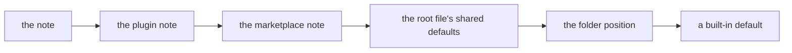

# skillwright vault structure, version 2

v2 has one goal: stable marketplace publishing, with transclusion and good
bundling. Its commands are `init`, `build`, `check` and `bump`.

This spec defines how skillwright reads a vault. A vault has one fixed layout.
The spec covers the folders, the root file, the notes, links, the frontmatter
rules and the output. The frontmatter keys themselves are in the
[field reference](../reference/fields.md), which is part of this spec.

The decisions behind this spec are in section 12. Edge cases are in
Appendix A. What v2
changes for a vault built with today's tool is in
[v2-changes.md](v2-changes.md).

## Words used here

| Word | Meaning |
|---|---|
| reads | skillwright loads a file as source. |
| interprets | skillwright acts on a link, call, embed or plugin-root path in some text. Text that is not interpreted ships exactly as written. |
| component | A skill, agent or command (section 3). |
| container | A marketplace or a plugin. |
| pack | The folder a harness installs for one plugin (section 9). |
| an error | The build or check stops and exits non-zero. Nothing is written. |
| an error for a harness | The same: the whole build fails, even though only that harness's output has the problem. The message names the harness. |
| a warning | Printed. The build goes on and exits 0. |

## Stability

- Stable: the layout (sections 1 to 3), the link and embed rules (sections 4
  and 5), the frontmatter fields (section 6) and what a pack holds (section 9).
  A breaking change to any of them makes a new version of this spec.
- There is no experimental layer. Flexibility is added later, as a new
  version.

## 1. The root

1. The vault is the folder that holds both `skillwright.md` and a
   `marketplaces/` folder. That folder is the root. A vault looks like this:

   ```text
   <root>/
   ├── skillwright.md                  the root file: shared settings
   ├── dist/                           build output
   └── marketplaces/
       └── <m>/
           ├── <m>.md                  the marketplace
           └── plugins/
               └── <p>/
                   ├── <p>.md          the plugin
                   └── skills/<s>/<s>.md
   ```

2. `--vault <path>` names the root. Without it, skillwright finds the root in
   these steps:
   1. Start at the working directory.
   2. If the folder holds both `skillwright.md` and `marketplaces/`, it is the
      root. Stop.
   3. Otherwise move to the parent folder and repeat step 2.
   4. At the top of the file system, fail. The error names any
      `skillwright.md` passed over on the way.

   Any other `skillwright.md`, such as a skill's note, is passed over (see
   Appendix A1).
3. v2 does not support a vault inside a larger notes vault. At the root, only
   `skillwright.md` and `marketplaces/` are read, and `dist/` is written
   (section 9). Only the root's direct children are checked. A `skills/`,
   `agents/`, `commands/`, `hooks/` or `plugins/` folder there is refused
   (section 11 case 4). Anything else at the root is left alone and not read,
   at any depth, such as `notes/` or `notes/marketplaces/`.

## 2. The root file

A complete root file, with every key it may hold:

```yaml
---
# Shared defaults. Every marketplace and plugin inherits these unless it
# sets its own.
author: Ada Lovelace            # or {name, email, url}
license: MIT                    # an SPDX expression
repository: https://github.com/acme/skills
homepage: https://acme.dev/skills
targets: [claude, codex]        # which harnesses get each component; absent means all
claude: {}                      # harness blocks: fields only that harness reads (section 8)
codex: {}
cursor: {}                      # {naming: bare} keeps plain skill names (section 8)
pi: {}                          # {naming: bare} likewise

# Tool settings.
build:
  harnesses: [claude, codex, cursor, pi]   # which harnesses to build; absent means all
  bump:
    patch: increment                       # or timestamp (section 10 rule 4)
---
```

1. `skillwright.md` exists only at the root. Its body is not read. It is the
   only configuration file.
2. It holds two kinds of key:
   - the shared defaults, which are the keys the key table marks as
     inherited (section 7 rule 1);
   - `build:`, the tool settings.
3. A key the key table does not list warns and is ignored, as
   [D-KVMB](../decisions/D-KVMB-bare-keys-by-default.md) says. There is one
   exception: `workspace` is a removed key and is refused (section 11).
4. A key the table lists but does not mark as inherited is refused here. The
   error names the note kinds that accept it:

   | Key | Belongs in |
   |---|---|
   | `owner` | a marketplace note, `<m>.md` |
   | `keywords`, `category` | a plugin note, `<p>.md` |
   | `description`, `version`, `display_name` | a marketplace or plugin note |
5. These `build:` keys are refused (section 11): `out`, `patterns`,
   `exclude`, `assets`, `hooks`, `destinations`, `scan_locations`,
   `launcher_path` and `namespace`. Any other unknown `build:` key warns.

## 3. Folders and notes

```text
<root>/
├── skillwright.md                  tool settings (build:) and shared defaults
├── dist/                           output, written by build (section 9)
└── marketplaces/
    └── <m>/
        ├── <m>.md                  the marketplace's note
        └── plugins/
            └── <p>/
                ├── <p>.md          the plugin's note
                ├── CHANGELOG.md    optional, copied into each pack
                ├── references/     shared docs, ship as references/
                ├── scripts/        shared code, ship as scripts/
                ├── assets/         shared output files, ship as assets/
                ├── skills/<s>/
                │   ├── <s>.md
                │   ├── references/
                │   ├── scripts/
                │   └── assets/
                ├── agents/<a>/<a>.md
                ├── commands/<c>/<c>.md
                └── hooks/
                    └── hooks.json  optional: the plugin's hooks (decision D4)
```

The layout follows the recommended practice of the Agent Skills standard. A
skill is a folder with its entry note and optional `references/`, `scripts/`
and `assets/` folders. Relative paths resolve from the skill's folder
(harness-reference: `Agent Skills Agent Skills format`,
`Agent Skills Relative paths in SKILL.md`).

### Containers and components

1. Every note is `<name>.md` in a folder of the same name. There is no other
   entry form. A flat `<name>.md` directly in a kind folder (`skills/`,
   `agents/`, `commands/`) is refused, and so is `SKILL.md`.
2. Position alone decides what a note is:

   | Folder | It is |
   |---|---|
   | `marketplaces/<m>/` | a marketplace |
   | `marketplaces/<m>/plugins/<p>/` | a plugin |
   | `<p>/skills/<s>/`, `<p>/agents/<a>/`, `<p>/commands/<c>/` | a component of that kind |
   | `<p>/hooks/` | the plugin's hooks folder: `hooks.json` only, no components |

   Frontmatter never decides kind, plugin or marketplace.
3. Each marketplace folder must hold `<m>.md`, and each plugin folder `<p>.md`.
   A missing note is an error that names the path it expects. The body of a
   container note is not interpreted and does not ship. It is for the author.
4. The folder's name is the note's name. The build writes it as the `name`
   each harness reads, such as the `name` in `SKILL.md`. There is no `name`
   key: a note that sets one, including in a harness block, is refused, and
   the error says to delete it.
5. A name follows the Agent Skills `name` rule:
   - lowercase letters `a` to `z`, digits and hyphens;
   - no hyphen at the start or end, and no two hyphens in a row;
   - at most 64 characters.

   So `review`, `pr-check` and `v2-tools` are names. `Review`, `-x` and
   `a--b` are refused.
6. Six names are reserved and refused for any marketplace, plugin or
   component: `marketplaces`, `plugins`, `skills`, `agents`, `commands` and
   `hooks`. A folder with one of these names is taken as a structure folder,
   so in a name position it is out of place (section 11).
7. Names are unique within a plugin, across all kinds. A skill and a command
   with one name in one plugin are refused, naming both. The same name in two
   plugins, or two marketplaces, is allowed.
8. Every note at a component position is a component. A skill, command or
   agent needs a `description`, because harnesses use it to pick the
   component. A missing `description` is an error that `build` and `check`
   report.
9. A component exists only inside a plugin, and a plugin only inside a
   marketplace. A `skills/`, `plugins/` or other kind folder anywhere else is
   an error (section 11), except below a `references/`, `scripts/`, `assets/`
   or never-ship folder, where it is an ordinary folder (rule 17).
10. One skill may be copied into two marketplaces. Each copy is its own
    component. There is no shared folder across plugins.
11. `check` warns when a plugin's `version` has no entry in its `CHANGELOG.md`.

### What a folder may hold

Below the root, each folder holds a fixed set of entries. Anything else is an
error that names the file and lists what the folder may hold.

Some entries are skipped everywhere, and one is an error:

| Entry | Result |
|---|---|
| A name that starts with `.`, such as `.DS_Store`, `.git` or `.obsidian` | Skipped: never read, never shipped, never an error |
| `node_modules/` | Skipped |
| `.mcp.json` in a plugin folder | An error: v2 has no home for it (decision D7) |

| Folder | May hold |
|---|---|
| The root | `skillwright.md`, `marketplaces/`, `dist/`. These three may not be symlinks. Anything else is left alone and not read, except the refused names of section 11 case 4. |
| `marketplaces/` | Marketplace folders only. |
| `marketplaces/<m>/` | `<m>.md`, `plugins/`. |
| `plugins/` | Plugin folders only. |
| `plugins/<p>/` | `<p>.md`, `CHANGELOG.md`, `references/`, `scripts/`, `assets/`, `skills/`, `agents/`, `commands/`, `hooks/`, and the never-ship folders `src/`, `docs/`, `tests/`, `fixtures/` (rule 15). |
| `skills/`, `agents/`, `commands/` | Component folders only. |
| `hooks/` | `hooks.json` only. A folder or any other file in it is an error. |
| `skills/<s>/` | `<s>.md`, `references/`, `scripts/`, `assets/`, and the never-ship folders `src/`, `docs/`, `tests/`, `fixtures/`. |
| `agents/<a>/`, `commands/<c>/` | Their note, and the never-ship folders `docs/`, `tests/`, `fixtures/`. |

So a `README.md` in `marketplaces/` or in `skills/` is an error.

12. In a skill, each folder has one job, and each ships inside the skill's
    folder under the same name:

    | Folder | Holds |
    |---|---|
    | `references/` | Docs the agent reads into context when it needs them. |
    | `scripts/` | Code the agent runs. |
    | `assets/` | Files used in output, such as templates, images and fonts. |

13. An agent or command installs as a single file, so it has no folder of
    its own to ship. It uses the plugin's shared folders.
14. A plugin's `references/`, `scripts/` and `assets/` are shared by every
    component in the plugin. Each ships under the same name at the pack root.
    Nothing is flattened: `assets/x` ships as `assets/x`.

    ```text
    plugins/tools/
    ├── scripts/deploy.sh        shared: ships as <pack>/scripts/deploy.sh
    ├── commands/deploy/
    │   └── deploy.md            one file: <pack>/commands/deploy.md
    └── skills/review/
        ├── review.md            ships as <pack>/skills/review/SKILL.md
        └── scripts/lint.sh      the skill's own: ships inside its folder
    ```
15. The never-ship folders never ship, and nothing may link or embed into
    them:

    | Folder | May sit in |
    |---|---|
    | `docs/`, `tests/`, `fixtures/` | a plugin or component folder |
    | `src/` | a plugin or skill folder |

    The names count only directly in a plugin or component folder. Inside
    `references/`, `scripts/` or `assets/` they are ordinary folders and ship
    (Appendix A8).
16. skillwright does not run builds. It only copies what is already in
    `scripts/`, `references/` and `assets/`. A built file is made in these
    steps:
    1. Its source sits in `src/`, or outside the vault.
    2. The author's own build step, such as `bun build` or a moon task, writes
       the output into the plugin's or skill's `scripts/`, `references/` or
       `assets/`.
    3. `skillwright build` copies it into each pack.

    ```text
    plugins/tools/
    ├── src/cli.ts           source: never ships
    ├── scripts/tool.js      written by `bun build src/cli.ts`, before skillwright build
    └── skills/review/
        └── review.md        calls ${PLUGIN_ROOT}/scripts/tool.js
    ```

    `scripts/tool.js` ships as `<pack>/scripts/tool.js`. Section 4 rules 15 to
    26 write the skill's `${PLUGIN_ROOT}/scripts/tool.js` for each harness.
17. Files inside `references/`, `scripts/`, `assets/` and the never-ship
    folders may be laid out in any folders below them, including folders with
    the structure names of rule 6. `scripts/` keeps each file's exec bit.

## 4. Links, embeds and containment

The syntax decides what a token is, not its target:

| You write | It is | What the build does |
|---|---|---|
| `/[[x]]` | A call (rule 8) | Writes the harness's call string |
| `![[x]]` | An embed (section 5) | Inlines the note, section or file |
| `[[x]]`, `[text](relative/path.md)` | A link | Checks the target is in scope, rewrites the path |
| `[text](https://…)`, `<https://…>`, `mailto:` and any other URL with a scheme | An external link | Ships as written, not checked |
| `[text](#heading)` | A link within the same file | Ships as written, not checked |
| `[text](/abs/path)` or `[text](file:…)` | A path outside the vault | Refused |
| `${PLUGIN_ROOT}/<path>` | A plugin-root path (rules 15 to 26) | Checks the file ships, rewrites per harness, inside code and link destinations too |
| Anything in a code span or fenced block | Literal (rule 12) | Ships as written, with two exceptions (rule 12) |

A plugin-root path is interpreted inside code, because a command in a code
block is where it is used. Source and output:

```markdown
Run `${PLUGIN_ROOT}/scripts/tool.js --check`.
```

| Pack | Ships as |
|---|---|
| Claude Code | ``Run `${CLAUDE_PLUGIN_ROOT}/scripts/tool.js --check`.`` |
| Codex, Cursor, Pi | ``Run `../../scripts/tool.js --check`.`` |

On Codex, Cursor and Pi the model resolves the relative path before it runs
the command (rule 19).

An external link is never fetched or checked, so a dead URL is not an error.
An embed resolves by the same scope rules as a link. The rules apply to a
component's note and to every Markdown file it ships.

### Containment

1. Each marketplace builds self-contained. A link, an embed or a shipped file
   that resolves outside `marketplaces/<m>/` is an error.
2. Every path is checked by its real path, with symlinks resolved. A symlink
   whose target lies outside the scope it is checked against is refused, in
   the same way as a link that spells that target.

### Scope of a link from a component

| Link target | Rule |
|---|---|
| A file in the component's own folder | Ships as written, relative. |
| A file in the plugin's `references/`, `scripts/` or `assets/` | Allowed. Rewritten to its installed path at the pack root. |
| Another component's note, or a file in its folder, same plugin | Allowed. Rewritten to its installed path. A link to a skill's or command's note also warns (rule 7). |
| A component the harness's pack does not contain, such as any agent | An error for that harness. |
| A file in another plugin | Refused. |
| Anything outside `marketplaces/<m>/` | Refused. |

A call, `/[[name]]`, is not a link and copies nothing. Its scope is the whole
marketplace (rule 8, decision D2).

3. A name-only link, `[[name]]`, resolves in up to two steps:

   ```mermaid
   flowchart TD
     A["[[name]]"] --> B{"Step 1: the linking file's component folder"}
     B -- "one match" --> R1["that file"]
     B -- "no match" --> C{"Step 2: the plugin's shared folders and components"}
     B -- "two or more" --> E1["error: names each match"]
     C -- "one match" --> R2["that file or component"]
     C -- "no match" --> E2["error: link to nothing"]
     C -- "two or more" --> E3["error: names each match"]
   ```

   - It never resolves outside the plugin.
   - What each step matches:

     | Step | Matches |
     |---|---|
     | 1 | a file at any depth in the linking file's component folder, outside its never-ship folders |
     | 2 | a file at any depth in the plugin's shared `references/`, `scripts/` and `assets/`, and another component by its name only |

   - Neither step searches a never-ship folder, such as `docs/` (section 3 rule 15).
     A name in both `references/` and `docs/` resolves to `references/`. A
     name whose only match is in the component's or the plugin's own
     never-ship folder is refused by rule 10.
   - A file inside another component's folder is never found by name. Link it
     with a path (rule 4), such as `[[../setup/references/notes.md]]`.
   - How a name matches a file name:
     - A name with no extension matches the file of that name or that name
       plus `.md`. `[[guide]]` matches `guide.md`.
     - A name with an extension matches only the file of that name.
       `[[run.sh]]` matches `run.sh`, never `run.sh.md`. An extension is a
       dot at the end of the name followed by letters and digits, at least
       one a letter, such as `.sh` or `.mp3`. So `[[v1.2 notes]]` has none
       and matches `v1.2 notes.md`.
     - Case is ignored. A link that matches only by ignoring case, such as
       `[[Guide]]` for `guide.md`, works and warns (`link-case`). The warning
       names the linking file, the link and the file it matched.
     - Two files whose names differ only in case, such as `guide.md` and
       `Guide.md`, both match `[[guide]]`. That is two matches, an error.
     - The same holds for a wikilink with a path (rule 4): a path with no
       extension may leave out `.md`, and one with an extension may not.
   - `[[setup]]` matches the component `setup` in step 2.
   - A file that belongs to no component, such as one in the plugin's shared
     `references/`, has no step 1. It starts at step 2.

   An example. `author.md` contains:

   ```markdown
   Follow [[guide]] and [[style]]. Then run [[setup]].
   See [[x]].
   ```

   The plugin `tools` holds:

   ```text
   marketplaces/acme/plugins/tools/
   ├── references/
   │   ├── guide.md                 shared
   │   └── style.md                 shared
   └── skills/
       ├── author/
       │   ├── author.md            the note that links
       │   └── references/guide.md  author's own
       └── setup/setup.md           another skill
   ```

   Each link resolves like this:

   | Link | Step 1: `skills/author/` | Step 2: shared folders and components | Result |
   |---|---|---|---|
   | `[[guide]]` | `references/guide.md` | not searched | `author`'s own `guide.md`. The shared one is not used. |
   | `[[style]]` | no match | `references/style.md` | the shared `style.md` |
   | `[[setup]]` | no match | the `setup` skill | a link to `setup`'s `SKILL.md`, with the warning of rule 7 |
   | `[[x]]` | no match | no match | an error. A skill `x` in another plugin is never searched. |

4. A link with a path resolves relative to the linking file. Its result must
   still fall in a row the table allows.
5. An installed path is written relative to where the linking file lands in the
   pack. Every harness built for keeps a pack whole on install, so the path
   holds after install (section 9).

   ```text
   .claude-plugin/packs/tools/
   ├── references/style.md          from SKILL.md: ../../references/style.md
   └── skills/author/
       ├── SKILL.md                 the linking file lands here
       └── references/guide.md      from SKILL.md: references/guide.md
   ```
6. A link to another component's note, or to a file in its folder, is rewritten
   to where that file lands in the same pack. The link text stays as written.
   From `skills/author/author.md`:

   | Source | Claude Code, Codex | Cursor, Pi (default naming) |
   |---|---|---|
   | `[[setup]]` | `[setup](../setup/SKILL.md)` | `[setup](../tools-setup/SKILL.md)` |
   | `[[setup#Usage]]` | `[setup](../setup/SKILL.md#Usage)` | `[setup](../tools-setup/SKILL.md#Usage)` |
   | `[[author]]` (its own note) | `[author](SKILL.md)` | `[author](SKILL.md)` |

   A fragment is kept. A component the harness's pack does not contain, such as an
   agent in any build or a command outside Claude Code, has no installed path.
   A link to it is an error for that harness.
7. A plain link to another skill's or command's note warns, naming the file
   and the link: `Did you mean to call /[[setup]]?`. The link still ships as a
   file link. A skill's link to its own note does not warn.
8. `/[[name]]` is a call (decision D3).
   - The `/` counts where it starts a line, or follows whitespace or one of
     `( " ' * > _ | [ =`. Anywhere else, such as `dir/[[x]]` or
     `[[A]]/[[B]]`, the `/` is text and `[[x]]` is an ordinary link.
   - A call to a skill renders as the string that runs it on that harness, in
     backticks. Nothing is copied. For the `setup` skill of plugin `tools`:

     | Harness | Default | With `naming: bare` (section 8 rule 6) |
     |---|---|---|
     | Claude Code | `` `/tools:setup` `` | same |
     | Codex | `` `$tools:setup` `` | same |
     | Cursor | `` `/tools-setup` `` | `` `/setup` `` |
     | Pi | `` `/skill:tools-setup` `` | `` `/skill:setup` `` |

   - A call with words keeps them: `/[[setup|the setup skill]]` renders as
     ``the setup skill (`/tools:setup`)``.
   - A fragment on a call, `/[[setup#Usage]]`, is an error, because a call
     cannot target a section. Link or embed the section instead.
   - The name is looked up among the marketplace's skills and commands
     (decision D2). A name found in no plugin of the marketplace is an error,
     even if another marketplace in the vault has it. A name two plugins
     share is an error that names both plugins. Rename one to fix it.
   - A call's result per target:

     | Call to | Claude Code | Codex, Cursor, Pi |
     |---|---|---|
     | a skill the pack contains | the call string above | the call string above |
     | a skill the pack does not contain (`targets`) | an error for that harness | an error for that harness |
     | a command | `` `/tools:deploy` `` | an error: their packs contain no commands |
     | an agent | an error: no pack contains agents | an error |
   - A call string written by hand in prose is an error that says to write
     `/[[setup]]`. One harness's form is wrong for the others. A string is
     checked in these steps:
     1. Take the call forms of every harness being built, with that
        harness's naming in effect for the plugin. For a command, take only
        the forms of harnesses whose packs contain commands.
     2. Keep only the forms that name the plugin. For the `setup` skill of
        plugin `tools`:

        | Form | Harness | Checked? |
        |---|---|---|
        | `/tools:setup` | Claude Code | Yes |
        | `$tools:setup` | Codex | Yes |
        | `/tools-setup` | Cursor, prefixed | Yes |
        | `/skill:tools-setup` | Pi, prefixed | Yes |
        | `/setup`, `/skill:setup` | Cursor or Pi with `naming: bare` | No. A bare name is too often other text, such as a path. |

     3. A form matches in prose when its sigil does not continue a word or
        path, and the character after it is not a letter `a` to `z`, a digit
        or `-`. So `/tools:setup-x` is not `/tools:setup`, and
        `/tools:setup.md` is.
     4. A match is an error. A match in a code span or fenced block is not
        checked and ships as written (rule 12).

     There is no escape form. To show a call string, put it in code.
9. `\/[[x]]` ships as the text `/[[x]]`. The leftover check of rule
   13 skips text an escape produced.
10. A link into a never-ship folder is refused with the same error in every
    link form.
11. A link to a missing file is an error that names the link.
12. Code is literal. Nothing inside a code span or fenced block is
    interpreted: no call, link or embed. A call written in code ships as
    written, so write calls in prose, where they render in backticks. There are
    two exceptions:

    | In code | Result |
    |---|---|
    | `${PLUGIN_ROOT}/<path>` | Rewritten (rule 15) |
    | `${CLAUDE_PLUGIN_ROOT}` | An error (rule 22) |

    A link, embed or call inside an HTML comment, `<!-- … -->`, is skipped
    too. It ships as written, and the leftover check of rule 13 skips it.
13. After the build, no unescaped `[[` may remain in prose.
    - Write `\[[` to keep the brackets as text: `\[[x]]` is not interpreted
      and ships as `[[x]]`. `\![[x]]` likewise ships as `![[x]]`.
    - A leftover `[[` is an error that names the file and the text.
    - Code spans and fenced blocks are not checked. Neither is text an escape
      produced.
    - The build marks escapes and other text internally with the Unicode
      noncharacters U+FDD0, U+FDD1 and U+FDD2. A Markdown body or an
      embedded file that holds one is refused (`noncharacter`).
14. Every error in this section names the linking file, the link as written and
    the rule it broke.

### Plugin-root paths

A component names a file of its plugin as `${PLUGIN_ROOT}/<path>`, such as
`${PLUGIN_ROOT}/scripts/tool`. The build replaces the string with each
harness's own form (decision D9).

15. Every `${PLUGIN_ROOT}/<path>` in a Markdown file a component ships is
    interpreted, in prose and code alike, because it is a path, not link
    syntax. The files are:
    - the component's note;
    - the Markdown files in its `references/`;
    - the Markdown files in the plugin's shared `references/`;
    - text a note embed inlines. An embedded non-note file, such as
      `![[run.sh]]`, is not interpreted (section 5 rule 9).

    Only the braced form is interpreted. `$PLUGIN_ROOT` is text.

    It is interpreted wherever it appears, a Markdown link destination
    included. `[the tool](${PLUGIN_ROOT}/scripts/tool)` ships as
    `[the tool](${CLAUDE_PLUGIN_ROOT}/scripts/tool)` on Claude Code and
    `[the tool](../../scripts/tool)` on the others, from a skill's note. Such
    a destination is checked by rule 17, not again as a relative link
    (rule 4).
16. The path runs to the first character that cannot continue a path. A
    letter, digit, `.`, `_`, `-` or `/` continues it. A `.` at the end of the
    path is not part of it, so a full stop after a path is punctuation:

    | Text | Path |
    |---|---|
    | `${PLUGIN_ROOT}/scripts/tool.js --check` | `scripts/tool.js` |
    | `Run ${PLUGIN_ROOT}/scripts/tool.` | `scripts/tool` |
17. The path is a path in the plugin's pack, laid out as section 9 places
    files for Claude Code:

    | Path | Names |
    |---|---|
    | `scripts/tool` | the plugin's shared `scripts/tool` |
    | `skills/setup/scripts/run.sh` | the `setup` skill's `scripts/run.sh` |
    | `commands/deploy.md` | the `deploy` command's note |

    It must name a file the build ships. If it does not, the build fails. The
    error names the file holding the reference and the reference as written.
18. In Claude Code's pack it is written as `${CLAUDE_PLUGIN_ROOT}/<path>`,
    which Claude Code expands in skill, command and agent text.
19. In Codex's, Cursor's and Pi's packs it is written as the path of that same
    file in that harness's pack, relative to the folder the text lands in.
    None of the three expands a variable in skill text.

    | Text lands in | `${PLUGIN_ROOT}/scripts/tool` becomes |
    |---|---|
    | `skills/review/SKILL.md` | `../../scripts/tool` |
    | `skills/review/references/guide.md` | `../../../scripts/tool` |
    | a file that embeds the text | the path from that file's folder |

    On Cursor and Pi, a path into a skill follows the skill's folder name
    there, `skills/<p>-<s>/` by default (section 8 rule 6). Only the path is
    rewritten. The file it names is copied as is.

    How the path is used:

    | Harness | The path in skill text | Who resolves it |
    |---|---|---|
    | Claude Code | `${CLAUDE_PLUGIN_ROOT}/<path>`, an absolute path once expanded | Claude Code |
    | Codex, Cursor, Pi | relative to the file it is written in | the model, before it uses the path |

    - The shell never reads `SKILL.md`. The model reads it and writes the
      command, so it turns the relative path into one it can run.
    - This holds for every relative path in skill text, to a reference or to a
      script, in the skill's own folders or the plugin's shared ones. A skill
      may run a plugin-shared script, such as `../../scripts/tool.js`.
    - The known risk: a model may paste the command as written. It then runs
      from the project folder, and the path does not resolve.
20. A path to a file the harness's pack does not contain is an error for that harness,
    the same as a link to it (rule 6). An example, in steps:
    1. `skills/review/review.md` contains
       `See ${PLUGIN_ROOT}/commands/deploy.md.`
    2. The Claude Code pack contains commands. It gets
       `See ${CLAUDE_PLUGIN_ROOT}/commands/deploy.md.`
    3. The Codex pack has no `commands/` folder, because the Codex pack contains no
       commands.
    4. So the build fails for Codex. The error names `review.md` and
       `${PLUGIN_ROOT}/commands/deploy.md`.
21. `${PLUGIN_ROOT}` with no `/<path>` after it is an error in Markdown. It
    cannot be rewritten to a path for Codex, Cursor or Pi, and a vault writes
    one text for all harnesses.
22. `${CLAUDE_PLUGIN_ROOT}` in interpreted text, code and link destinations
    included, is an error
    that says to write `${PLUGIN_ROOT}`. Interpreted text is the files of rule
    15 (a component's note, the Markdown in its own and the plugin's
    `references/`, and text a note embed inlines) and `hooks/hooks.json`. A
    file that ships byte for byte, a never-ship folder and a container note's
    body are not checked. There is one syntax. To show Claude Code's variable
    in an example, write it unbraced, `$CLAUDE_PLUGIN_ROOT`.
23. A hooks file, `hooks/hooks.json`, also writes `${PLUGIN_ROOT}`. Each hook
    command's `${PLUGIN_ROOT}` becomes the harness's own variable:

    | Harness | Ships hooks? | `${PLUGIN_ROOT}` in a hook becomes |
    |---|---|---|
    | Claude Code | Yes | `${CLAUDE_PLUGIN_ROOT}` |
    | Codex | Yes | `${PLUGIN_ROOT}`, unchanged |
    | Cursor | No, for now. The build leaves hooks out of the Cursor pack and warns, naming `hooks/hooks.json`. It warns only when it builds that plugin's Cursor pack: Cursor is in `build.harnesses` and in the plugin's `targets`. | nothing |
    | Pi | No: Pi has no shell hooks | nothing |

    - A hook runs as a shell command from the project folder, where a
      pack-relative path would not resolve. So hooks keep a variable.
    - Cursor documents `${CURSOR_PLUGIN_ROOT}` only in `mcp.json`, not for
      hook commands (harness-reference: `Cursor Plugin root variable`). A hook
      that relied on it could fail at run time with no sign at build time. So
      the Cursor pack ships no hooks until that is confirmed (see "Later").
    - A lone `${PLUGIN_ROOT}` is allowed in a hook, since the variable is
      kept. A path after it is checked by rule 17.
24. A file that is neither Markdown nor a hooks file, such as a script in
    `scripts/`, ships byte for byte and is never rewritten. A script should
    find its own files relative to itself, such as `$(dirname "$0")/lib.sh`,
    not through a harness variable.
25. A code example that shows a shell `${PLUGIN_ROOT}` is interpreted as a
    plugin-root path, and rewritten or refused. To show the shell variable,
    write it unbraced, `$PLUGIN_ROOT/x`. The shell reads it the same way, and
    the build leaves it alone. There is no escape form.
26. A skill's own file named by a plain relative path, such as `scripts/x.py`
    in its `SKILL.md`, is text. It ships as written and is not checked. Like
    every relative path in skill text, it is relative to the file it is written
    in, and the model resolves it before using it (rule 19). The model may
    paste it as written, which runs it from the project folder. What each
    source records:

    | Source | Records |
    |---|---|
    | The Agent Skills standard | relative to the skill's folder (`Agent Skills Relative paths in SKILL.md`) |
    | Cursor, Pi | relative to the skill's folder (section 9 rule 14) |
    | Claude Code | not recorded for plain paths; `${CLAUDE_SKILL_DIR}` names the skill's folder |
    | Codex | not recorded; see [the plan](v2-plan.md) for the evidence probe |

    Use `${PLUGIN_ROOT}/<path>` for a file the build should check, and for any
    file outside the skill's folder.

## 5. Transclusion

An embed, `![[target]]`, is replaced at build time by the target's content.
Embeds are resolved before links are rewritten, so the output holds no `![[`.

A worked example. The source skill note, `skills/review/review.md`:

````markdown
## Steps

![[guide#Usage]]

Then run this:

![[run.sh]]
````

The embedded files, `skills/review/references/guide.md`:

```markdown
# Guide

## Usage

Run the check before each commit.

## History

Old notes.
```

and `skills/review/scripts/run.sh`:

```sh
#!/bin/sh
cargo test --workspace
```

The shipped `skills/review/SKILL.md`:

````markdown
## Steps

## Usage

Run the check before each commit.

Then run this:

```bash
#!/bin/sh
cargo test --workspace
```
````

The `Usage` section is inlined without `History`. `run.sh` is inlined as a
fenced block whose info string comes from its extension (rule 10).

### What may be embedded

1. The target resolves by the scope rules of section 4: the embedding file's
   own component folder, then the plugin's shared folders and components. An
   embed outside that scope is refused with the same error as a link.
2. The target's type decides what is inlined:

   | Target | Result |
   |---|---|
   | A note (`.md`) | Its body is inlined (rules 4 to 8). |
   | An image (`.avif`, `.bmp`, `.gif`, `.jpeg`, `.jpg`, `.png`, `.svg`, `.webp`) | A Markdown image link to the file's installed path. |
   | Any other text file | A fenced code block (rules 9 to 14, decision D8). |

3. An embed whose target does not exist is an error that names the embed. An
   embed inside a code span or fenced block is not interpreted (section 4
   rule 12).

### Inlining a note

4. `![[note]]` inlines the note's body. Its frontmatter is dropped. A note
   whose frontmatter is malformed, such as an unclosed `---` or invalid YAML,
   is an error that names the embedded note and the embedding note. With a
   broken fence the end of the frontmatter is unknown, so YAML could be
   inlined as prose, or prose dropped.
5. `![[note#Heading]]` inlines one section.
   - The section runs from the heading line to the line before the next
     heading of the same or a shallower level, so subsections come with it.
   - A heading is an ATX heading (`#` to `######`) outside fenced code.
   - `![[note#Parent#Child]]` names the heading by its last segment. The
     segments before it are the nearest headings above it, in order.
   - A selector is first tried as one heading's whole text, since a heading
     may contain `#`. The first heading that matches wins.
6. `![[note#^id]]` inlines one block.
   - A `^id` marker at the end of a line labels the paragraph that line ends,
     or the one list item it ends.
   - A marker alone on a line labels the paragraph or list above it.
   - The marker is not part of the inlined text.
7. A heading or block that is not found is an error, `fragment-unresolved`,
   that names the note and the fragment.
8. The inlined text is trimmed of leading and trailing whitespace and replaces
   the embed in place. Nothing marks where it came from.

### Inlining another text file

9. `![[run.sh]]` inlines the file as a fenced code block. The content is never
   escaped or changed. Nothing in it is interpreted: no link, call, embed or
   `${PLUGIN_ROOT}`, and a `${CLAUDE_PLUGIN_ROOT}` in it is not an error.
10. The fence's info string comes from the file's extension through a fixed
    table, such as `.sh` to `bash` and `.py` to `python`. An extension the
    table does not list gives no info string.
11. The fence is backticks, one more than the longest run of backticks that
    starts a line of the file, after up to three spaces of indent. It is never
    fewer than three. A file holding a ```` ``` ```` block is fenced with four.
12. Inside a list item, every line of the block is indented to the item's
    content, so the block stays in the item.
13. A file that is not valid UTF-8 is binary, and embedding it is refused. A
    fragment on an embed that is not a note, whether a file inlined or an
    image included, is refused: `![[run.sh#main]]` and `![[logo.png#x]]`
    both are.
14. A plain `[[run.sh]]` is not an embed. It stays a file link to the file's
    installed path.

### Nesting

15. An embedded note may embed others. Each level is expanded the same way.
16. A cycle is an error, `cycle`, that prints the loop from its first repeat,
    such as `a.md -> b.md#Setup -> a.md`.
    - A hop is a file and a fragment, so two embeds of different sections of
      one note are not a cycle.
    - A note that embeds itself is a cycle.

### Links inside embedded text

17. A link or embed inside embedded text resolves from the embedded file: its
    own folder and its own component's scope, as if it were interpreted in
    place.
18. It is then written relative to where the text lands, the file that holds
    the outermost embed. The same note embedded into two files links
    differently in each.
19. A call (`/[[name]]`) inside embedded text renders as it would in place.

## 6. Frontmatter

1. There is no key prefix. A prefixed key, such as `sw-version` or an `sw:`
   block, is an unknown key.
2. One closed table lists the keys of each kind. It drives the build's strip,
   validation and the field reference.
3. A key outside the table warns.
   - On a component it is emitted under `metadata:` as YAML.
   - On a container or in the root file it is ignored.
4. `license` on a plugin or marketplace is the pack's licence. On a skill it is
   the Agent Skills `license` field.
5. `build:` is read only in the root file. In any other note it is refused.
6. Malformed frontmatter, such as an unclosed `---` or invalid YAML, is an
   error that names the note. This holds for every note, and for a note that
   is embedded (section 5 rule 4).

## 7. The cascade

A value comes from the first of these sources that has one:



1. A key inherits only if the key table marks it as inherited. Those keys are
   `author`, `license`, `repository`, `homepage`, `targets` and the harness
   blocks. They are the root file's shared defaults (section 2). Harness
   blocks inherit key by key.
2. The order for an inherited key is component, then plugin, then marketplace,
   then root. Each container is matched by folder.
3. Inheritance applies to every component a build reads.
4. Some keys in a container's harness block stay with the container. A member
   never takes them, even where its kind accepts them, and this rule wins over
   rule 1. They are, per harness:
   - in a plugin's or marketplace's block, the keys of that harness's plugin
     manifest and of its marketplace entry for a plugin. A skill or command
     never takes them;
   - in a marketplace's block, the keys of that harness's marketplace
     manifest, such as Codex's `interface` and Claude Code's `metadata`, and
     `description`, `version`, `displayName` and `source`. A plugin never
     takes them;
   - in any block, a key the member's kind does not accept.

   The keys use the harness's own spelling, so a block holds `displayName`,
   not `display_name`. The manifest, entry and marketplace key lists of each
   harness are closed. The field reference lists the keys that stay, per
   harness, in its "kept" lines (`docs/reference/fields.md`, "Harness
   blocks"): "Plugin, kept from skills and commands" and "Marketplace, kept
   from plugins". So a block a component inherits cannot set its
   `description` or `version`. `name` is not among these keys: section 3
   rule 4 refuses it in a harness block too.
5. For an inherited key (rule 1) that a harness reads on a component, the
   build takes the first value in this order:
   1. the note's own harness block;
   2. the note's frontmatter;
   3. for each container, nearest first: its harness block, then its own
      frontmatter;
   4. a generated value.

   An example. The plugin note sets `author: Ada` and `claude: {author: Bob}`.
   The plugin's Claude Code manifest names `Bob` as its author, and its Codex
   manifest names `Ada`. A skill takes no `author`: it is a plugin key (rule
   4). A key that is not inherited, such as `description`, comes only from the
   note itself.
6. Versions:
   - A plugin's `version` is its note's. Without one it is `0.1.0`, with a
     warning.
   - A marketplace's `version` is its note's. Without one, the marketplace
     manifests hold no version, and there is no warning.

## 8. Harness blocks

1. `claude:`, `codex:`, `cursor:` and `pi:` hold fields only that harness reads.
2. A block is checked against the keys that harness accepts. An unknown key
   warns and is left out of what that harness gets, on a component and on a
   container. There is one exception: `packs` is a removed key and is refused
   (rule 5, section 11). A known key with a wrong value is refused.
3. A block is merged over what skillwright generates, and `metadata` merges with
   the note's own.
4. A block is emitted only for its harness.
5. `packs` is refused in a block. Each harness's packs folder is fixed (section 9).
6. Skill names on Cursor and Pi. Neither has a plugin namespace, so two
   plugins' skills of one name would collide there (harness-reference:
   `corpus/notes/skill-naming-across-harnesses.md`). So:

   | Harness | Skill `review` of plugin `tools` | Why |
   |---|---|---|
   | Claude Code | `skills/review/`, `name: review` | The harness puts the plugin name in front itself (`tools:review`). |
   | Codex | `skills/review/`, `name: review` | The same. |
   | Cursor | `skills/tools-review/`, `name: tools-review` | No plugin namespace. |
   | Pi | `skills/tools-review/`, `name: tools-review` | No plugin namespace. |

   - `cursor: {naming: bare}` or `pi: {naming: bare}` keeps the plain `<s>`
     on that harness. The only values are `bare` and `prefixed`.
     `bare` stays available because Cursor's own first-party plugins use plain
     names, such as `deslop`.
   - `naming` may be set on a plugin, a marketplace or the root file. It
     inherits key by key, like other harness-block keys (section 7), so a
     marketplace's `pi: {naming: bare}` reaches every plugin below it unless
     a plugin sets its own. On a component it is refused, and the error says
     to set it on the plugin.
   - A prefixed name over 64 characters is an error.
   - Two skills that end up with one name on a harness are an error for that
     harness, naming both plugins:

     | Naming | Collision | Fix |
     |---|---|---|
     | `bare` | plugins `tools` and `ops` each have a skill `review` | remove `bare` from one, or rename one skill |
     | `prefixed` | plugin `a-b`'s skill `c` and plugin `a`'s skill `b-c` are both `a-b-c` | rename one |

## 9. Bundling and output

### Where output goes

1. `build` writes each marketplace to `<root>/dist/<m>/`. There is no setting
   and no flag that moves it.
2. Under `dist/<m>/`, each harness's tree has that harness's default layout:
   its marketplace manifest and its packs folder, one pack per plugin.

   | Harness | Marketplace manifest | Pack |
   |---|---|---|
   | Claude Code | `.claude-plugin/marketplace.json` | `.claude-plugin/packs/<p>/` |
   | Codex | `.agents/plugins/marketplace.json` | `.agents/packs/<p>/` |
   | Cursor | `.cursor-plugin/marketplace.json` | `.cursor-plugin/packs/<p>/` |
   | Pi | none | `.pi/packs/<p>/` |

   ```text
   dist/acme/
   ├── .claude-plugin/
   │   ├── marketplace.json
   │   └── packs/tools/             one pack per plugin
   ├── .agents/
   │   ├── plugins/marketplace.json
   │   └── packs/tools/
   ├── .cursor-plugin/
   │   ├── marketplace.json
   │   └── packs/tools/
   └── .pi/packs/tools/             Pi has no marketplace manifest
   ```

3. Which packs contain a component is decided in two steps:
   1. The harnesses built (section 10 rule 7) pick which harness trees are
      written.
   2. A component's `targets` picks which of those harnesses get it.

   A harness's pack contains a component only when both name the harness, and
   the harness takes its kind (the pack table below). A link, call or
   plugin-root path to a component a pack does not contain is an error for
   that harness (Appendix A5).
4. A build replaces only what skillwright owns in `dist/<m>/`: each harness's
   packs folder and the manifests it writes. When a harness's owned paths
   hold a file this build does not produce and no file there carries
   skillwright's generated-file marker, `build` and `check` refuse
   (`foreign-tree`) and write nothing.
5. Output is never written inside `marketplaces/`, and it is never read as
   source. Since only `marketplaces/` is read, this needs no check.
6. The build stops at `dist/`. Copying the output to a repository root,
   committing it or publishing a marketplace from it is the consumer's job.

### What a pack holds

This is the one place that says what ships and where it lands. `<pack>` is the
pack folder from the table above.

| Source | Lands at | Harnesses |
|---|---|---|
| The plugin's manifest, from `<p>.md` | The harness's manifest path in `<pack>`. For Pi this is `package.json`, which Pi treats as optional; skillwright always writes it. | All |
| `plugins/<p>/CHANGELOG.md` | `<pack>/CHANGELOG.md`, byte for byte | All |
| `plugins/<p>/references/`, `scripts/`, `assets/` | `<pack>/references/`, `<pack>/scripts/`, `<pack>/assets/` | All |
| `skills/<s>/<s>.md` | `<pack>/skills/<s>/SKILL.md`, compiled | All. Cursor and Pi name the folder `<p>-<s>` unless `naming: bare` is set for them (section 8 rule 6). |
| `skills/<s>/references/`, `scripts/`, `assets/` | The same names inside the skill's folder | All |
| `commands/<c>/<c>.md` | `<pack>/commands/<c>.md`, compiled | Claude Code only |
| `hooks/hooks.json` | The harness's hooks file in `<pack>` | Claude Code, Codex. Not Cursor, for now (section 4 rule 23). |
| `agents/<a>/<a>.md` | Nothing. No pack contains an agent. | None |

7. Compiled means these steps, in order:
   1. calls, links, embeds and plugin-root paths are tokenized in one pass,
      before any of them is rewritten. So `/[[setup]]` is a call, never a
      link with a `/` before it;
   2. embeds are inlined (section 5), and a note embed's text is tokenized
      the same way;
   3. calls are rendered, links rewritten and plugin-root paths rewritten;
   4. the frontmatter is reduced to what that harness reads.

   For example, a plugin's source and its Claude Code pack:

   ```text
   marketplaces/acme/plugins/tools/    dist/acme/.claude-plugin/packs/tools/
   ├── tools.md                     →  ├── .claude-plugin/plugin.json
   ├── CHANGELOG.md                 →  ├── CHANGELOG.md          byte for byte
   ├── scripts/tool                 →  ├── scripts/tool          byte for byte
   ├── skills/review/                  ├── skills/review/
   │   ├── review.md                →  │   ├── SKILL.md         compiled
   │   └── references/guide.md      →  │   └── references/guide.md  compiled
   ├── commands/deploy/deploy.md    →  ├── commands/deploy.md    Claude Code only
   ├── hooks/hooks.json             →  ├── hooks/hooks.json
   └── agents/helper/helper.md         (nothing: no pack contains an agent)
   ```
8. Every Markdown file in a shipped `references/` folder is compiled the same
   way. Every other file, including all of `scripts/` and `assets/` and
   `CHANGELOG.md`, is copied byte for byte. So a template keeps any `[[` it
   holds.
9. `src/`, `docs/`, `tests/` and `fixtures/` directly in a plugin or
   component folder never ship (section 3 rule 15).
10. A file keeps its exec bit. A file in `scripts/` that is meant to run must
    be executable in the source; the build does not set the bit.
11. A pack holds no symlinks. Every shipped file is a copy.
12. `targets` and `build.harnesses` accept only `claude`, `codex`, `cursor`
    and `pi`. Any other value is refused, and the error names the four.

### Install keeps a pack whole

13. Links up to the pack root rely on the harness keeping a pack whole on
    install.
14. harness-reference records this for each harness built for:

    | Harness | Pack kept whole | Relative paths in a skill |
    |---|---|---|
    | Claude Code | Yes: a marketplace plugin is copied whole to `~/.claude/plugins/cache/<m>/<p>/<version>`, and nothing outside the plugin folder is copied (`Claude Code Plugin install copy`, `Claude Code Plugin install location`) | `${CLAUDE_SKILL_DIR}` names the skill's folder (`Claude Code Relative paths in SKILL.md`). Plain relative paths are not recorded. |
    | Codex CLI | Yes: the plugin is copied whole to `~/.codex/plugins/cache/<m>/<p>/<version>` (`Codex CLI Plugin install copy`, `Codex CLI Plugin install location`) | Not recorded (`Codex CLI Relative paths in SKILL.md open`) |
    | Cursor | Recorded for a local install only: plugin files are copied to `~/.cursor/plugins/local`, and a symlink loads only when its target is inside that folder (`Cursor Plugin install copy`, `Cursor Plugin install location`). A marketplace install is not recorded. | The skill's root (`Cursor Relative paths in SKILL.md`) |
    | Pi | Yes: a local package loads in place, a git package is cloned, an npm package is installed whole (`Pi Plugin install copy`, `Pi Plugin install location`, `Pi Plugin install 1.5.0`) | The skill's folder, and the model is told it (`Pi Relative paths in SKILL.md`) |

    Cursor's rule that a symlink loads only when its target is inside its
    plugin folder never applies, because a pack holds none (rule 11).

### check

15. `check` runs every rule `build` runs and writes nothing. It then compares
    the result with `dist/<m>/`. Any difference is drift, and `check` exits 1.
    A missing `dist/<m>/` is drift too.

## 10. Commands

v2 has four commands. Every other command is out of v2 (see "Later"). An
unknown command, such as `publish`, is a usage error and exits 3. The error
does not say the command was removed.

1. `init <m> <p>` writes the skeleton in the working directory:

   ```text
   ./
   ├── skillwright.md
   └── marketplaces/<m>/
       ├── <m>.md
       └── plugins/<p>/<p>.md
   ```

   Both names follow section 3 rule 5. `init` refuses a folder that already
   holds `skillwright.md`.
2. `build` builds every marketplace. `--marketplace <m>` builds only `<m>`.
   The working directory never picks a marketplace.
3. `check` runs `build`'s rules and writes nothing (section 9 rule 15). It
   checks every marketplace, or only the one `--marketplace <m>` names.
4. `bump` raises a `version` in a note:
   - `bump <p>` raises the plugin `<p>`'s version in `<p>.md`. If plugins in
     two marketplaces share the name, add `--marketplace <m>`.
   - `bump --marketplace <m>`, with no plugin name, raises the marketplace's
     version in `<m>.md`.
   - `bump --changed-since <ref|dir>` bumps each plugin whose built output
     differs from the baseline while its `version` has not moved.
   - `build.bump.patch` says how the patch number moves. `increment` (the
     default) adds one: `1.2.3` becomes `1.2.4`. `timestamp` sets it to the
     UTC time as `YYYYMMDDHHMMSS`, or to one more than the current patch when
     that is larger: `1.2.3` becomes `1.2.20261110153000`.
5. The flags:

   | Flag | Taken by | Does |
   |---|---|---|
   | `--vault <path>` | `build`, `check`, `bump` | Names the root (section 1 rule 2). |
   | `--marketplace <m>` | `build`, `check`, `bump` | Picks one marketplace (rules 2 to 4). |
   | `--harness <name>` | `build`, `check`, `bump` | Picks a harness to build: `claude`, `codex`, `cursor` or `pi`. Repeat it for several (rule 7). Any other name is a usage error, exit 3. |
   | `--json` | `build`, `check`, `bump` | Writes the report to stdout as one JSON document. |
   | `--quiet` | `build`, `check`, `bump` | Drops progress and the tally from stderr. |
   | `--dry-run` | `build`, `bump` | Reports what would be written, and writes nothing. |
   | `--yes` | `build`, `bump` | Writes without asking (rule 6). |
   | `--changed-since <ref\|dir>` | `bump` | Rule 4. |
   | `--major`, `--minor`, `--patch` | `bump` | Which part of the version rises. `--patch` is the default. |

   `init` takes only its two names. There is no other flag.
6. `build` and `bump` print what they will write and ask before they write.
   `--yes` skips the question. Without a terminal and without `--yes`, they
   stop with a usage error, exit 3, and write nothing.
7. The harnesses built are those `--harness` names, or the core request's
   `harnesses` list, when given; else the root file's `build.harnesses`;
   else all four. A list given for a run replaces the root file's, and may
   name a harness the root file leaves out. The root file's list is only the
   default. `bump --changed-since` builds and compares the same harnesses.

## 11. A vault not in this layout

skillwright reads this layout and no other. A vault that does not match is
refused before anything is read further. The error says what was found, where,
and prints the expected layout:

```text
<root>/
├── skillwright.md                   build settings and shared defaults
└── marketplaces/<m>/
    ├── <m>.md
    └── plugins/<p>/
        ├── <p>.md
        ├── skills/<s>/<s>.md   (also agents/, commands/)
        └── hooks/hooks.json
```

It is refused when:

1. No folder at or above the working directory holds both `skillwright.md` and
   `marketplaces/`, and no `--vault` is given. If a `skillwright.md` was passed
   over on the walk, the error names it.
2. The root file has `workspace`, or a key the table lists but does not mark
   as inherited (section 2 rule 4). An unlisted key only warns (section 2
   rule 3).
3. A marketplace folder has no `<m>.md`. If it holds a `skillwright.md`, the
   error says the marketplace note is now `<m>.md`.
4. A kind folder (`skills/`, `agents/`, `commands/`), a `hooks/` folder or a
   `plugins/` folder is directly in the root, or anywhere in `marketplaces/`
   other than its place in section 3, such as directly in a marketplace.
   Below a `references/`, `scripts/`, `assets/` or never-ship folder it is
   an ordinary folder, as any folder is there (section 3 rule 17).

   ```text
   <root>/
   ├── skills/                      refused: a kind folder at the root
   └── marketplaces/acme/
       ├── skills/                  refused: directly in a marketplace
       └── plugins/tools/skills/    accepted
   ```
5. A `marketplaces/` folder is inside `marketplaces/`, other than below a
   `references/`, `scripts/`, `assets/` or never-ship folder. There it is an
   ordinary folder, so a plugin's `tests/fixtures/` may hold a whole test
   vault. Nothing in it is read as part of the vault.
6. A component's note is not `<name>/<name>.md`, such as `skills/x.md` or
   `skills/x/SKILL.md`.

   ```text
   plugins/tools/skills/
   ├── review/review.md             accepted
   ├── lint.md                      refused: a flat note
   └── setup/SKILL.md               refused: write setup/setup.md
   ```
7. The root file has a refused build key: `build.out`, `build.patterns`,
   `build.exclude`, `build.assets`, `build.hooks`, `build.destinations`,
   `build.scan_locations`, `build.launcher_path` or `build.namespace`. Or a
   harness block has a `packs` key.
8. A folder holds an entry its row in "What a folder may hold" (section 3)
   does not list, such as a plugin's `bin/` or a `notes.md` beside a skill's
   entry.

Each case is reported once, with every path it applies to.

## 12. Decisions

Each decision below can be read on its own: what it covers, the rule, and
why. What each one changes for an existing vault is in
[v2-changes.md](v2-changes.md).

### D1. `build.out` and `--out`

**What it is.** `build.out` in `skillwright.md`, or `--out` on the command
line, says where `build` writes its output.

**Decided.** Both are dropped. Output always lands in `<root>/dist/<m>/`, such
as `plugin/dist/osdlc/.claude-plugin/`. A repo that wants the catalog at its
own root copies it there, for example in CI.

**Why.**

- The build stops at one fixed place, and nothing else needs a setting.
- Output that can land anywhere needs the output-overlaps-source checks and
  the `stale-output` warning. A fixed place needs neither.
- `bump --changed-since` uses its own temporary folder.

### D2. The scope of a call

**What it is.** How far `/[[name]]` looks for the skill it calls.

**Decided.** A call looks across the whole marketplace. `/[[review]]` finds
`review` in any plugin of the marketplace. A name two plugins share is an
error that names both plugins; rename one. Links and embeds stay within the
plugin.

**Why.**

- A call copies no file, so it does not break containment.
- Calls across plugins are common, such as `/sdlc:task-work` from a `craft`
  skill. An own-plugin scope could not express them.
- The cost: a call can name a skill in a plugin the user did not install. The
  harness then reports an unknown command at run time.

### D3. Calls and plain links to a skill

**What it is.** What `/[[setup]]` and `[[setup]]` mean when `setup` is a skill.

**Decided.** The syntax decides, not the target. v2 keeps the call and makes a
plain link a real link (section 4 rules 6 to 8).

- `/[[setup]]` is a call, with the `/` positions and the `\/[[` escape of
  section 4 rules 8 and 9. A call with words keeps them. A fragment on a call is an error.
- `[[setup]]` is a file link to the skill's installed `SKILL.md`, under the
  normal link scope (same plugin). `[[setup#Usage]]` links to that section.
- A skill's link to its own note is a file link to its own file.
- A plain link to another skill's or command's note warns
  `Did you mean to call /[[setup]]?`. A self-link does not warn.
- There is no mention form. Nothing renders a skill's name on its own.
- Code is literal, so a call in a code span is not interpreted.

**Why `/` and not `@`.**

- `/` matches how Claude Code runs a skill or command, `/name`, so the source
  reads like its output.
- Vaults written today already use it, so nothing has to be rewritten (see
  [v2-changes.md](v2-changes.md)).
- Its cost is the clash with paths, such as `dir/[[x]]`. The call-position
  rule handles that: a `/` inside a word or path is text.
- `@` was considered and rejected.
  - In Claude Code and Cursor it means mention or attach, `@file` or
    `@agent`, which is what a plain link already does.
  - It clashes with email addresses and GitHub `@user` mentions.
  - Every existing vault would have to be rewritten.
- Codex runs skills with `$` either way. The build writes each harness's own
  form from `/[[name]]`.

### D4. `build.assets` and `build.hooks`

**What it is.** Two lists in `skillwright.md` that copy extra files into a
plugin's pack.

**Decided.** Both are dropped. The author puts the file in the plugin:

| Source | Ships as |
|---|---|
| `plugins/tools/assets/LICENSE` | `<pack>/assets/LICENSE` |
| `plugins/tools/hooks/hooks.json` | each harness's hooks file |

**Why.**

- The plugin folder already says where things go.
- `hooks/hooks.json` is the path Claude Code reads by default
  (harness-reference: `Claude Code Plugin manifest fields`).
- Keeping the lists would mean two settings with their own path checks, and
  `plugin: tools` would need a marketplace prefix to be unambiguous.
- The cost: a file shared by several plugins is copied into each.
- A file built from source outside the plugin no longer needs a copy rule.
  The author's build step writes it into the plugin's `scripts/`,
  `references/` or `assets/`, and skillwright copies it from there (section 3
  rule 16).
- A real consumer, the `sdlc` plugin, ships about 25 `assets:` entries from
  outside its vault to arbitrary pack paths. It fits this pattern (see the
  consumer note in [v2-changes.md](v2-changes.md)).

### D5. `build.exclude`

**What it is.** A list of globs in `skillwright.md` for files that never ship.

**Decided.** `build.exclude` is dropped. A file that must not ship goes in a
`docs/` folder, such as `skills/review/docs/notes.md`. `docs/` never ships.

**Why.**

- `docs/` already does the job, and the layout stays the only rule.
- An excluded file would also need an exemption from the folder rules of
  section 3, which refuse `notes.draft.md` beside `review.md`. That would be a
  second way to say what a folder may hold.

### D6. Plugin notes are required

**What it is.** Whether `plugins/<p>/<p>.md` must exist.

**Decided.** The note is required. `plugins/tools/` with no `tools.md` is an
error that names the missing path. `init` writes the note.

**Why.**

- Every plugin has one file that holds its settings and its `version`.
- `bump` needs a note to write the version to.
- A note without a `version` still builds as `0.1.0`, with a warning
  (section 7 rule 6). The warning points at the one file to fix.

### D7. `.mcp.json`

**What it is.** A plugin's MCP server configuration. Claude Code reads
`.mcp.json` at the plugin root (harness-reference: `Claude Code MCP config
file`). Claude Code, Codex and Cursor also read an `mcpServers` manifest field.

**Decided.** `.mcp.json` has no home in v2. A `.mcp.json` in a plugin folder
is an error that says so (section 3, "What a folder may hold"). It is not
skipped like other dot-named files. An MCP server kind comes later and writes
each harness's own file.

**Why.**

- A copied `.mcp.json` is right for Claude Code and may be wrong for the other
  harnesses, whose files and keys differ.
- A file that is right for one harness and wrong for others breaks installs
  quietly.
- Skipping it silently would break them quietly too, so it is an error.

### D8. Embedding a file that is neither a note nor an image

**What it is.** `![[name]]` where the target is, say, a script or a CSV file.

**Decided.** A text file is inlined as a fenced code block (section 5 rules 9
to 14). With `scripts/run.sh` holding `echo hi`, `![[scripts/run.sh]]` ships as:

````text
```bash
echo hi
```
````

- The info string comes from the extension: `.sh` gives `bash`, `.py` gives
  `python`, and an extension not in the table gives none.
- The fence is one backtick longer than the longest backtick run that starts a
  line in the file, and never fewer than three.
- The content is never escaped or changed. So a file with its own
  ```` ``` ```` block and `[[` text ships intact.
- Inside a list item, the block is indented to match the item.
- A binary file (not valid UTF-8) is refused. A fragment on a non-note file,
  `![[run.sh#main]]`, is refused.
- A plain `[[run.sh]]` stays a file link.

### D9. Plugin-root paths replace `build.launcher_path`

**What it is.** How a component or a hook names a file of its plugin, such as
a launcher script, so that the path works on every harness.

**Decided.** `build.launcher_path` is dropped and refused. Authors write
`${PLUGIN_ROOT}/<path>` (section 4 rules 15 to 26).

| Where | Source | Claude Code | Codex, Cursor, Pi |
|---|---|---|---|
| A skill's `SKILL.md`, prose or code | `${PLUGIN_ROOT}/scripts/tool` | `${CLAUDE_PLUGIN_ROOT}/scripts/tool` | `../../scripts/tool` |
| `hooks/hooks.json` | `${PLUGIN_ROOT}/scripts/hook.sh` | `${CLAUDE_PLUGIN_ROOT}/scripts/hook.sh` | Codex `${PLUGIN_ROOT}/…`; Cursor and Pi no hooks (section 4 rule 23) |

- Every path is checked to name a file the pack ships.
- A path to a file in `scripts/`, `references/` or `assets/` is rewritten the
  same way, whether a skill's own or the plugin's shared copy. A path has one
  meaning, so it has one rule. The files themselves are copied as they are.
- `${PLUGIN_ROOT}` with no path after it is an error in Markdown. There is no
  path to rewrite it to for three harnesses.
- A target the harness's pack does not contain is an error for that harness, as a link
  to it is. A dead path breaks the skill at run time with no sign at build
  time.
- Hooks get each harness's own variable, and their paths are checked. A
  hook runs from the project folder, so a relative path would not resolve.
- `${CLAUDE_PLUGIN_ROOT}` in source is an error that says to write
  `${PLUGIN_ROOT}`. One syntax means one thing to search for and check.
- Scripts ship byte for byte. A script finds its own files relative to itself.

**Why a build-time string replacement.** No harness but Claude Code expands
a plugin-root variable in skill text, so the variable cannot be left for the
harness to fill in.

| Harness | Expands a plugin-root variable in skill text? | Source |
|---|---|---|
| Claude Code | Yes, `${CLAUDE_PLUGIN_ROOT}` | `Claude Code Plugin root variable` |
| Cursor | No. Its variables expand only in `mcp.json`, and `${PLUGIN_ROOT}` is not one of them. Whether it sets `${CURSOR_PLUGIN_ROOT}` for hooks is not recorded either, so its pack ships no hooks (section 4 rule 23). | `Cursor Plugin root variable` |
| Codex | No. `PLUGIN_ROOT` is documented only for hooks. | |
| Pi | No | |

So the build replaces the string. Claude Code gets its own variable, and the
other harnesses get a relative path.

**Why `${PLUGIN_ROOT}`.**

- It is the open Agent Plugins standard's name (harness-reference:
  `Agent Plugins Plugin root variable`).
- It reads as the shell variable it becomes, so the source looks like a
  working command.
- It names no harness. The vault is written once for every harness, and its
  text should not favour one.
- It is the name Codex already uses for hooks, so on Codex a hook ships as
  written.
- Keeping `${CLAUDE_PLUGIN_ROOT}` was rejected. It names one harness, and the
  source would read as if Claude Code were the target while three of four
  packs get something else.
- A template token such as `{{plugin}}` was rejected. It reads as neither a
  path nor a variable, it is close to the `{{harness}}` and `{{event}}` hook
  placeholders, and a source file using it is not runnable as written.

**The cost.** A code example that shows a shell `${PLUGIN_ROOT}`, such as
documentation of a Codex hook, is interpreted as a plugin-root path. It is
rewritten, or refused when it names no shipped file. The simplest fix needs no
new syntax: write the variable unbraced, `$PLUGIN_ROOT`. The shell reads it
the same way, and the build leaves it alone. So v2 has no escape form for it.

**Why.**

- Any plugin path works on every harness, not just one configured file.
- The plugin's folders are fixed, so the build knows where every file lands
  and can rewrite any path.
- The check turns a typo or a moved file into a build error instead of a
  failure at run time.

## Later

The layout is deliberately the recommended practice and nothing more. More
flexible structures may come in a later version of this spec.

These commands are out of v2 and may return in later milestones: `publish` to
a skills folder, `harness install`, `update`, `uninstall`, `link` and
`unlink`, `adopt`, `new`, `rename`, `move`, `build --watch`, and the other
current commands (`list`, `status`, `delete`, `convert`, `author`,
`unpublish`).

Build steps declared in `skillwright.md`, such as `build.before:`, may come
later. `build` would run them; `check` never would.

Richer hook authoring (hook notes) may come later; see
[#152](https://github.com/osdlc/skillwright/issues/152). v2 reads hooks only
from `hooks/hooks.json`. Hooks in the Cursor pack return when a probe confirms
that Cursor sets `${CURSOR_PLUGIN_ROOT}` for hook commands, tracked in the same
issue.

## Appendix A: Edge cases

Each case gives an input and the result.

1. **A component named `skillwright`.** A skill named `skillwright` has a note
   called `skillwright.md`. So the walk up from inside it meets a second
   `skillwright.md`. It is never taken for the root, because only the root
   has `marketplaces/` beside it.

   ```text
   <root>/
   ├── skillwright.md                      the root file: marketplaces/ is beside it
   └── marketplaces/acme/plugins/tools/
       └── skills/skillwright/
           └── skillwright.md              a skill's note: no marketplaces/ beside it
   ```

   The six structure names are reserved (section 3 rule 6), so a component
   named `marketplaces` cannot hold a `marketplaces/` folder.

   A whole vault copied inside another vault's tree is a different case. A
   walk up that starts inside the inner vault stops at the inner root, so the
   build reads the inner vault. A build started outside it reads only the
   outer root's `skillwright.md` and `marketplaces/` (section 1 rule 3). v2
   does not support nested vaults.
2. **A dot-named file a pack needs.**
   - Input: `assets/.eslintrc.json`.
   - Result: skipped. It does not ship, and there is no warning.
   - Fix: name it without the dot, and have the script or skill that uses it
     copy it to the dotted name.
   - `.mcp.json` in a plugin folder is the one dot-named file that is an
     error (decision D7).
3. **A link from a plugin's shared reference.**
   - Input: `plugins/tools/references/style.md` contains `[[guide]]`, and the
     plugin has `references/guide.md`.
   - Result: step 1 is skipped, since the file belongs to no component. Step
     2 searches the shared folders and component names. It finds
     `references/guide.md` and not `skills/author/references/guide.md`, which
     sits inside a component. It ships as `[guide](guide.md)`.
4. **A name that matches deep in a folder.**
   - Input: `[[layout]]`, with `references/design/layout.md` in the skill.
   - Result: it matches, at any depth. If `references/old/layout.md` also
     exists, it is an error that names both.
5. **A component left out by `targets`.**
   - Input: skill `deploy` sets `targets: [claude]`. Skill `review`, shipped
     everywhere, contains `/[[deploy]]`.
   - Result: Claude Code renders `` `/tools:deploy` ``. The build fails for
     Codex, Cursor and Pi, naming `review.md` and the call.
   - Fix: give `review` the same `targets`, or move the call out of it.
6. **A plugin and a marketplace with one name.**
   - Input: marketplace `osdlc` holds plugin `osdlc`.
   - Result: `bump osdlc` bumps the plugin. `bump --marketplace osdlc` bumps
     the marketplace.
7. **Two prefixed names that collide.**
   - Input: plugin `a-b` has skill `c`; plugin `a` has skill `b-c`.
   - Result: both are `a-b-c` on Cursor and Pi. That is an error for those
     harnesses, naming both. Claude Code and Codex are not affected.
8. **A never-ship name inside a shipped folder.**
   - Input: `skills/review/references/docs/x.md` and
     `plugins/tools/scripts/src/main.js`.
   - Result: both ship. `docs/` and `src/` are never-ship folders only
     directly in a plugin or component folder.
9. **`check` with no output yet.**
   - Input: a fresh clone with no `dist/`.
   - Result: `check` reports drift and exits 1. Run `build` first.
10. **A path at the end of a sentence.**
    - Input: `Run ${PLUGIN_ROOT}/scripts/tool.`
    - Result: the path is `scripts/tool`. The full stop stays as text.
11. **An indented fence in an embedded file.**
    - Input: `notes.txt` holds a line that starts with three spaces and
      ```` ``` ````.
    - Result: it counts. The embed's fence uses four backticks.
12. **A call in a container note.**
    - Input: the plugin note's body says `` Run `/[[setup]]` first. ``
    - Result: nothing. A container note's body is not interpreted and does
      not ship.
13. **Showing Claude Code's variable in a doc.**
    - Input: a code span `` `${CLAUDE_PLUGIN_ROOT}/x` ``.
    - Result: an error. Write `` `$CLAUDE_PLUGIN_ROOT/x` `` instead.
14. **Malformed frontmatter in an embedded note.**
    - Input: `![[guide]]`, and `guide.md` opens with `---` but never closes
      it.
    - Result: an error that names `guide.md` and the embedding note.
15. **`naming` on a skill.**
    - Input: a skill note sets `pi: {naming: bare}`.
    - Result: refused. The error says to set it on the plugin.
