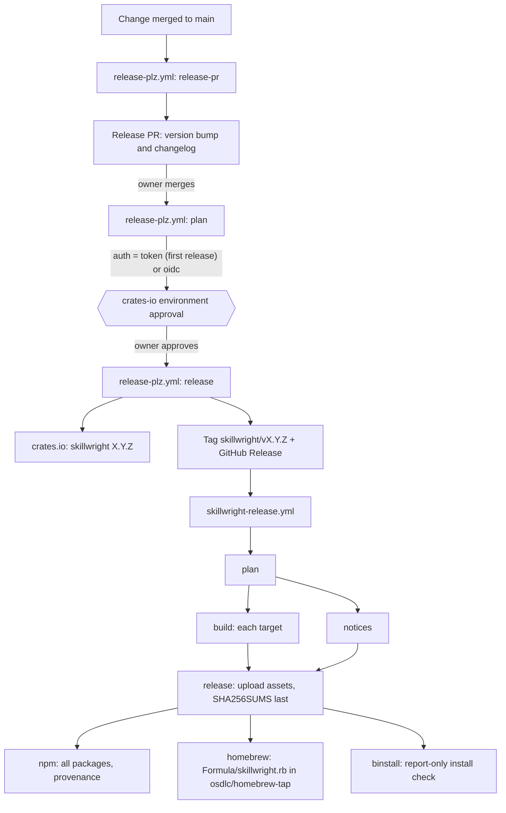
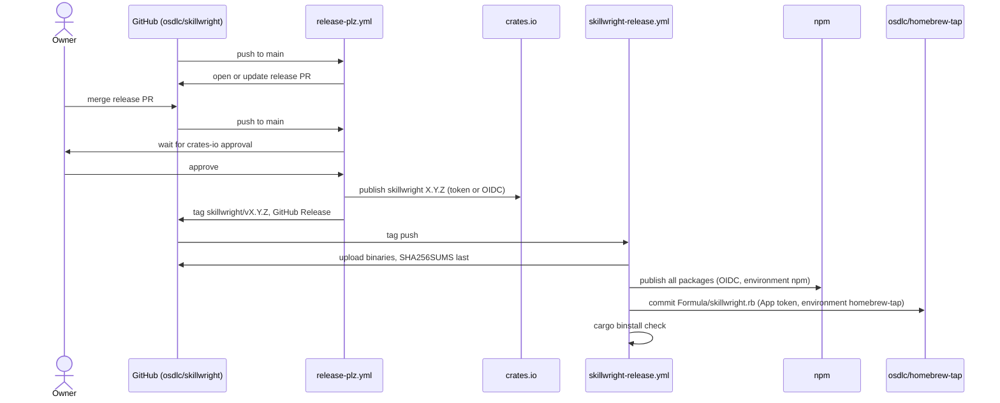
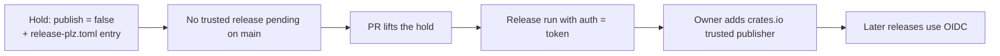

# Releasing skillwright

How a `skillwright` version gets from a merged change to every install
channel. It names settings and secrets, never their values.

The tooling itself is described in [`release/README.md`](release/README.md).

## Channels

| Channel | Install | Published by |
|---|---|---|
| crates.io | `cargo install skillwright` | `release-plz.yml`, job `release` |
| GitHub Release | `install.sh`, direct download | `skillwright-release.yml`, job `release` |
| npm | `npm i -g @osdlc/skillwright` | `skillwright-release.yml`, job `npm` |
| Homebrew | `brew install osdlc/tap/skillwright` | `skillwright-release.yml`, job `homebrew` |
| cargo-binstall | `cargo binstall skillwright` | Reads the GitHub Release assets; job `binstall` checks it |

## The flow



1. **Release PR.** On every push to main, `release-pr` opens or updates a
   pull request that bumps each changed crate's version and changelog. It
   also rebuilds the wasm and commits it to the PR. The `osdlc-release`
   GitHub App opens it, so its checks run.
2. **Merge.** The owner merges the release PR once its checks pass.
3. **Plan.** `plan` compares each crate's version with crates.io. If nothing
   is new it stops. Otherwise it picks one credential for the run:
   - `token` when a crate has never been published (its first release);
   - `oidc` (trusted publishing) for new versions of existing crates.
   A run that needs both is refused. See [First release of a crate](#first-release-of-a-crate).
4. **Approve.** The `release` job waits for approval of the `crates-io`
   environment. The owner approves it in the Actions tab.
5. **Publish and tag.** `release` publishes each new crate version, then the
   App pushes the tag `skillwright/vX.Y.Z` and creates the GitHub Release.
6. **Binary release.** The tag starts `skillwright-release.yml`:
   - `build` makes one binary per target, and `notices` writes
     `THIRD_PARTY_NOTICES.md`. The targets and packages are listed in
     [`release/product.ts`](release/product.ts).
   - `release` uploads the assets. It never replaces a published asset, and
     uploads `SHA256SUMS` last.
   - `npm`, `homebrew` and `binstall` run from those uploaded bytes.
     `binstall` is report-only (`continue-on-error`): a failure there does
     not undo the release.

## Who does what



Owner-only actions: merging the release PR, approving the `crates-io`
environment, and the one-time setup below. Everything else is automatic.

## Required environments and secrets

The owner sets these up once, before the first release. They are in
osdlc/skillwright. Values live only in GitHub settings.

| Environment | Used by | Holds | Limited to |
|---|---|---|---|
| `release-plz` | `release-plz.yml` `release-pr` | `RELEASE_PLZ_APP_ID`, `RELEASE_PLZ_APP_PRIVATE_KEY` | main, no reviewer |
| `crates-io` | `release-plz.yml` `release` | `CARGO_REGISTRY_TOKEN` (publish-new-only), the App secrets | main, owner approval |
| `npm` | `skillwright-release.yml` `npm` | nothing; the job's OIDC token is the credential | main and `skillwright/v*` |
| `homebrew-tap` | `skillwright-release.yml` `homebrew` | `RELEASE_PLZ_APP_PRIVATE_KEY` | main and `skillwright/v*` |

`homebrew-tap` and `npm` should be limited to main and `skillwright/v*`.

The `osdlc-release` App needs these permissions:

- osdlc/skillwright: contents write and pull-requests write (see the
  `permission-` inputs in `release-plz.yml`);
- osdlc/homebrew-tap: contents write.

A tag ruleset on `*/v*` lets only the
App and admins create release tags.

The release workflows stop at once when they run in any repository other
than osdlc/skillwright.

## Moving releases from osdlc/osdlc

skillwright and tradecraft-core were released from osdlc/osdlc up to
skillwright 0.3.8 and tradecraft-core 0.40.1. The owner moves the release
here once, in this order. Steps 1 and 4 are done.

1. **Done** ([osdlc/osdlc#555](https://github.com/osdlc/osdlc/pull/555)).
   **Hold both crates in osdlc/osdlc first.** This is a hard prerequisite
   for every later step. Merge the osdlc/osdlc pull request that sets
   `publish = false` in `packages/rust/skillwright/Cargo.toml` and
   `packages/rust/tradecraft-core/Cargo.toml`, and adds a `[[package]]` entry with
   `publish = false` and `release = false` for each to its
   `release-plz.toml`. Blocking tags there is not enough. osdlc's
   release-plz has `release_always = true`, and it publishes to crates.io
   before it tags. A release run there could still publish either crate
   from osdlc code, and the tag push would then fail, leaving a published
   version with no tag in either repository. Once the trusted publishers
   move, its `release-pr` would also keep bumping both crates and its
   publish would fail.
2. Install the `osdlc-release` App on osdlc/skillwright.
3. Create the four environments in the table above, with their secrets and
   branch limits, and the tag ruleset. The ruleset must let admins bypass
   it, so that the owner can push the tags in the next step. Do all of
   this before any release workflow runs here.
4. **Done:** the six tags below are pushed and point at their commits.
   Push the release tags imported from osdlc/osdlc. The tags of the same
   names in osdlc/osdlc point at osdlc commits that are not in this
   history, so do not copy those. Each tag here points at the imported
   commit with the same tree:

   | Tag | Commit in this repository |
   |---|---|
   | `skillwright/v0.3.7` | `c25536c3aff18186821687b3850cbad4e4a96564` |
   | `skillwright/v0.3.8` | `4d758afdd23bb939d03f33799403b37ff4cde53d` |
   | `tradecraft-core/v0.39.1` | `d42466145c624568b9b106fbcf2ea9c072109445` |
   | `tradecraft-core/v0.39.2` | `1604eb3cb1b7ba767242bca6f72e69cd03b506e8` |
   | `tradecraft-core/v0.40.0` | `742ba7954e0881de5962fb59c5233f7e302020a1` |
   | `tradecraft-core/v0.40.1` | `4d758afdd23bb939d03f33799403b37ff4cde53d` |

   From a clone with these tags (create any missing one with
   `git tag -a <tag> <commit> -m "chore: Release package <crate> version <version>"`):

   ```sh
   git push origin skillwright/v0.3.7 skillwright/v0.3.8 \
     tradecraft-core/v0.39.1 tradecraft-core/v0.39.2 \
     tradecraft-core/v0.40.0 tradecraft-core/v0.40.1
   ```

   Then check that each tag on the remote peels to the commit in the
   table:

   ```sh
   git ls-remote --tags origin 'skillwright/*' 'tradecraft-core/*' | grep '\^{}'
   ```

   release-plz stops its history walk at the tag of each crate's last
   release. Without these tags, `release-pr` walks into the imported
   commits, which have no Cargo workspace, and fails. Its first step checks
   for them.
5. In osdlc/osdlc, remove the `skillwright/v*` branch policy from its
   environments and block new `skillwright/v*` and `tradecraft-core/v*` tags
   there.
6. Move the trusted publishers. On crates.io, for `skillwright` and
   `tradecraft-core`: add repository `osdlc/skillwright`, workflow
   `release-plz.yml`, environment `crates-io`, then delete the osdlc/osdlc
   entry. On npm, for `@osdlc/skillwright` and the four
   `@osdlc/skillwright-<os>-<cpu>` packages: set repository
   `osdlc/skillwright`, workflow `skillwright-release.yml`, environment `npm`.
7. Merge the pull request that adds the release workflows. Then dry-run
   release-plz:

   ```sh
   gh workflow run release-plz.yml --repo osdlc/skillwright --ref main -f dry_run=true
   ```

   Do not dry-run `skillwright-release.yml` at an imported tag. Those trees
   have no Cargo workspace, so its `notices` and `build` jobs fail there.
   Its first run is the tag cut in the next step.
8. Release the next version from this repository: merge the release pull
   request that `release-pr` opens. Expect skillwright 0.3.9 and
   tradecraft-core 0.40.2, both published with trusted publishing: `plan`
   should print `auth=oidc`. If it prints `token`, stop. That means a crate
   looks unpublished, and the run would use the shared token. Then check
   every channel (see [Checking a release](#checking-a-release)).

## First release of a crate

crates.io and npm both allow trusted publishing only for a package that
already exists. So a new crate or package needs one-time steps.



**crates.io**

1. A new crate starts held: `publish = false` in its `Cargo.toml` and a
   `[[package]]` entry with `publish = false` and `release = false` in
   `packages/rust/release-plz.toml`.
2. Lift the hold in a pull request of its own, merged only when no other
   crate is waiting on a trusted-publishing release. To check, compare the
   versions on main with crates.io (`plan` prints the same table).
3. The release run uses `CARGO_REGISTRY_TOKEN`.
4. The owner adds a trusted publisher on crates.io: repository `osdlc/skillwright`,
   workflow `release-plz.yml`, environment `crates-io`.

**npm**, before the first tag: an npm owner of `@osdlc` stages a
placeholder for each package and adds its trusted publisher. See
[First release on npm](release/README.md#first-release-on-npm).

**Homebrew**: the `homebrew-tap` environment needs
`RELEASE_PLZ_APP_PRIVATE_KEY`, and the App must be installed on
osdlc/homebrew-tap.

## Checking a release

After the binary release finishes:

```sh
brew update && brew tap osdlc/tap && brew trust osdlc/tap
brew install osdlc/tap/skillwright && skillwright --version
npm i -g @osdlc/skillwright && skillwright --version
cargo binstall -y skillwright && skillwright --version
cargo install skillwright && skillwright --version
curl -fsSL https://github.com/osdlc/skillwright/releases/download/skillwright/vX.Y.Z/install.sh | sh
```

Each prints `skillwright X.Y.Z`. Homebrew 7 needs a third-party tap to be
trusted once, so the tap and trust commands come before `brew install`.

## When something fails

| Symptom | Cause | Fix |
|---|---|---|
| `plan` refuses the run | A first release and a trusted release are both pending | Release one first; hold the other |
| `release` waits forever | The `crates-io` approval was not given | Approve it in the Actions tab |
| `npm` fails with `404 Not Found - PUT` | The package or its trusted publisher does not exist | Stage the package (see [First release on npm](release/README.md#first-release-on-npm)), then re-run failed jobs |
| `homebrew` fails: `private-key` input must be set | `RELEASE_PLZ_APP_PRIVATE_KEY` missing from `homebrew-tap` | Add it, then re-run failed jobs |
| release-plz waits on the index, then times out | crates.io's sparse index lags the API (seen for agent-adapt 0.19.1: the API listed the version for hours before the index did) | Wait for the index, then re-run |
| `wasm` check fails on a PR | The committed wasm differs from CI's build | `release-pr` rebuilds and commits the wasm on the release PR. On other PRs, take the files from that run's `tradecraft-wasm` artifact |

Re-run only the failed jobs:

```sh
gh run rerun <run-id> --repo osdlc/skillwright --failed
```

Published assets are never replaced, so a re-run ships the same bytes. A
re-run after a release reuses the uploaded binaries and skips `build` and
`notices`. See [Re-running a release](release/README.md#re-running-a-release).
